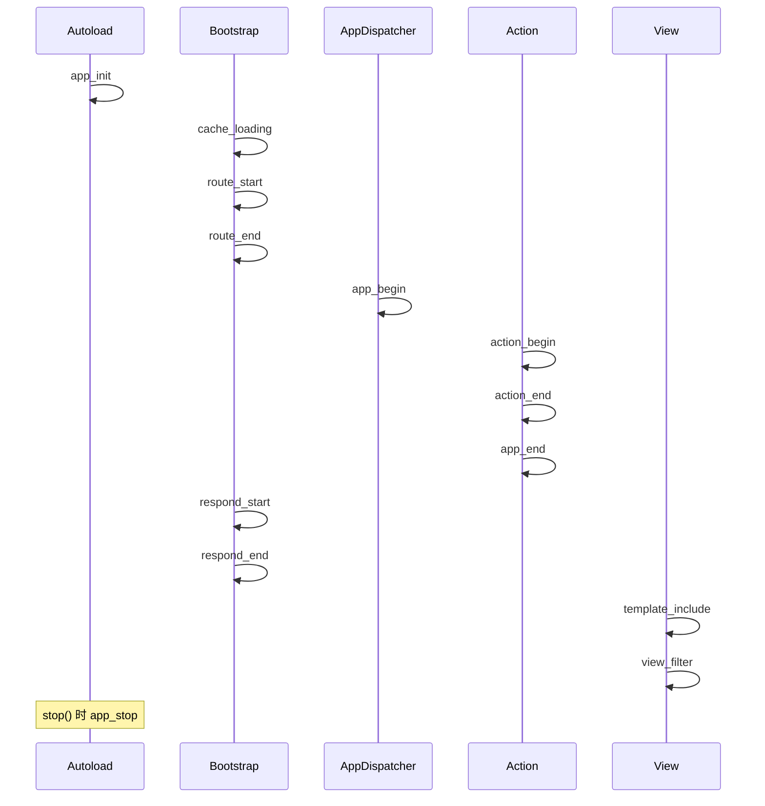

# Hook 标签清单

> 最后修订：**2026-07-22**  
> 系统说明与学习路径见 **[Hook 钩子系统](Hook钩子系统.md)**。

Candy 通过 **`Hook` + `listen()`** 在请求生命周期中插入扩展逻辑。标签须先 **`Hook::import()`** 注册后，`listen($tag)` 才会执行；未注册的标签调用 `listen()` 将直接返回 `false`。

## 注册入口

| 文件 | 加载时机 | 作用域 |
|------|----------|--------|
| [`Application/tags.php`](../../../Application/tags.php) | `Candy/Autoload.php` 启动 | 全局（**仅显式注册**，不自动扫描 Vendor） |
| [`Application/{App}/tags.php`](../../../Application/Admin/tags.php) | `AppDispatcher::dispatch()` 分发前 | 当前应用 |

Vendor 包可自带 `tags.php` 供参考；是否启用由项目在 `Application/tags.php` 或应用级 `tags.php` **手动 `include` / 写入行为类**，框架不会自动加载。

### 行为类约定

- 类须实现 **`run($params = null)`** 方法（或通过 `Hook::add` 注册闭包 / `类::静态方法`）
- 推荐放在 `Source/Class/Behaviors/`，命名空间 `APP\Extend\Behaviors`
- 返回 **`false`** 可中断同标签后续行为链

### 触发函数

```php
listen('app_begin');                    // 执行该标签全部行为
listen('view_filter', $html, true);     // 仅取第一个非空返回值
```

---

## 生命周期总览



---

## 标签明细

### 启动与路由（Bootstrap / Autoload）

| 标签 | 触发位置 | 典型参数 | 说明 |
|------|----------|----------|------|
| `app_init` | `Candy/Autoload.php` | 无 | 框架常量、Autoload、`Application/tags.php` 加载完成后 |
| `cache_loading` | `Bootstrap::boot()` | 无 | 使用非文件缓存驱动时；Catlog Xhprof 可挂此标签 |
| `route_start` | `Bootstrap::route()` | 无 | **URL 解析前**；Apidoc `CandyService` 注册路由 |
| `route_end` | `Bootstrap::route()` | 无 | **URL 解析后**、End 中间件 / `System.inc` / 租户解析 / `App::loading()` **之前** |

### 应用与控制器（AppDispatcher / Action）

| 标签 | 触发位置 | 典型参数 | 说明 |
|------|----------|----------|------|
| `app_begin` | `AppDispatcher::dispatch()` | 无 | 控制器实例化前；Admin 合并网站品牌文案 |
| `action_begin` | `Action::working()` | 无 | 单个操作方法执行前（已通过权限校验） |
| `action_end` | `Action::working()` | 无 | 单个操作方法执行后 |
| `app_end` | `Action::working()` 末尾 | 无 | 请求业务逻辑结束、`Finish` 中间件前 |
| `app_stop` | `stop()`（`kernel.func.php`） | 无 | 主动终止脚本时 |

### 响应（Bootstrap）

| 标签 | 触发位置 | 典型参数 | 说明 |
|------|----------|----------|------|
| `respond_start` | `Bootstrap::respond()` | 无 | 主体输出已由 Action 完成后的收尾起点 |
| `respond_end` | `Bootstrap::respond()` | 无 | 响应管道结束 |

### 视图（View）

| 标签 | 触发位置 | 典型参数 | `$once` | 说明 |
|------|----------|----------|--------|------|
| `template_include` | `View::runTemplateInclude()` | 无 | 否 | 编译模板 `include` 执行前 |
| `view_filter` | `View` 输出过滤链 | HTML 字符串 | **是** | 最终 HTML 过滤；首个非空结果生效 |
| `view_{name}` | `View::__call()` | `['view'=>View, 'args'=>[]]` | 否 | 扩展视图魔术方法；须先 import 该标签 |

> `view_{name}` 仅在 `C('TAGS_VIEW_'.strtoupper($name))` 已设置时由 `View::__call` 触发，需自行 `Hook::import(['view_xxx' => [...]])`。

### 数据库（DBServer）

| 标签 | 触发位置 | 典型参数 | 说明 |
|------|----------|----------|------|
| `db_query` | `DBServer` 写操作前 | `tabName`, `method`, `args`, `data` | INSERT/UPDATE/DELETE 等执行前 |
| `db_after` | `DBServer` 写操作后 | 同上 + 执行结果 | 写操作完成后 |

适用于审计日志、同步缓存、统计等；**读操作不触发**。

---

## 可选全局函数钩子（非 listen）

部分扩展点**不必**走 `tags.php` / `listen()`，与 `Node::checkAuth` 的 `getUserRole` / `getUserAuths`、`loadLocale` 的 `locale_check` 相同：框架在固定时机 `function_exists`，业务自行实现即可。

| 函数 | 调用位置 | 返回值 | 说明 |
|------|----------|--------|------|
| `getTenantID` | `Bootstrap::resolveTenantContext()`（`route()` 内、`App::loading()` 前） | `string\|null` | 当前请求六位租户 ID；未实现或返回空 → `C('TENANT_ID')=null`（平台/公共路径） |
| `loadTenantDbConfig` | `resolveTenantDbConfig()`（缓存未命中时） | `array\|null` | 从总库（platform）按 ID 拉取连接配置；框架随后 `registerTenantDbConfig` 补录缓存。**须打 platform/默认库，禁止 `M/D(..., true)`** |
| `getTenantDbConfig` | `resolveTenantDbLink()`（可选覆盖） | `string\|array\|null` | 完全接管索库；**未实现或返回 null** 时走 `DBLIST` → 缓存 → `loadTenantDbConfig` |

框架已提供（**非钩子**，登录必调 / 补录时自动调）：

| 函数 | 说明 |
|------|------|
| `registerTenantDbConfig($tenantId, $config, $ttl?)` | 写共享缓存 + DBLIST；登录签发前手动调，缓存未命中补录时框架自动调 |
| `resolveTenantDbConfig($tenantId)` | 按 ID 索库（DBLIST → 缓存 → 总库补录） |
| `forgetTenantDbConfig($tenantId)` | 吊销/停用时清理缓存与 DBLIST 项 |
| `getUserRole` | `Node::_getUserRole()` | `string` | 自定义角色读取 |
| `getUserAuths` | `Node::_getUserAuths()` | `array` | 自定义权限节点读取 |
| `locale_check` | `Bootstrap::loadLocale()` | `string\|null` | 语言检测（现网在 `Source/Func/global.func.php`） |
| `localizeActInfo` | `Node::resolveActionActInfo()` | `array` | actInfo 本地化 |

### `getTenantID` 约定

- **非必须**：不实现时行为与改前一致（无租户代码隔离）
- **放置**：`Source/Func/*.func.php`（`boot()` 已加载，早于 `route()`）
- **时序**：Session / JWT / 路由已就绪；尚未 `App::loading()`、语言包、控制器分发
- **格式**：六位 `[A-Za-z0-9]`；非法值按非租户处理并记调试信息
- **读取**：`Bootstrap::tenantId()` 或 `C('TENANT_ID')`（每请求覆盖写入，防 Workerman 串租户）

```php
// Source/Func/global.func.php（示例，业务自行实现）
function getTenantID(): ?string
{
    // 从 Session / JWT claim / 域名映射等解析；非租户返回 null
    $id = session('tenantId') ?: null;
    return $id !== null && $id !== '' ? (string) $id : null;
}
```

后续 MVCS / 模板 / 插件 / 扩展 均采用 **层内** `Tenant/{id}/`（有 `TENANT_ID` 时由框架自动优先，无则回退公共）：

| 根 | 租户路径（优先） | 无则回退 |
|----|------------------|----------|
| Application / Addons | `{根}/{Controls\|Models\|Services\|Validates\|Schemas\|Views\|Languages}/Tenant/{id}/…` | 同层公共文件 |
| Plugins | `Plugins/{Plug}/{Controls\|…\|Views\|Languages\|Hook}/Tenant/{id}/…` | 同层公共文件 |
| 外部模板 `Home@./Template` | `Template/{style}/Tenant/{id}/…` | `Template/{style}/…` |
| 运行时 NS | `APP\{Layer}\{App}\Tenant\{id}\…`（仅应用侧租户源码） | `APP\{Layer}\{App}\…` |
| 编译产物 | `*.tenant.{id}.class.php` | 原有 `.own/.parent/…`（不含 `.tenant.`） |

路径拼装统一入口：`Bootstrap::tenantOverlayPath()` / `tenantOverlayFile()` / `resolveAppRoot()`。

业务仅需实现 `getTenantID`（及分库时的 `M/D(..., true)` / `getTenantDbConfig`），按需放置租户覆写文件即可。

### 业务缓存键（自动租户隔离）

`Cache::store()` / `F()` 等走 `prefix()` 的路径：

| 请求上下文 | 物理键 |
|------------|--------|
| 无 `TENANT_ID` | `{cachePrefix}{key}`（默认空间） |
| 有 `TENANT_ID` | `{cachePrefix}t/{id}/{key}` |
| 逻辑键 `@xxx` | `{cachePrefix}xxx`（平台共享，如 `G()`） |

跨租户共享：`Cache::sharedKey('foo')` 或 `cacheSharedKey('foo')`。详见 `raw/doc/TenantFrameworkIsolationMemo.md` §5.5。

### 上传与旁路文件（自动租户隔离）

与 Cache 同一路径段 `t/{id}/`：

| 请求上下文 | 上传根 | 向量 PHP |
|------------|--------|----------|
| 无 `TENANT_ID` | `Public/uploads/` | `Data/vector/{alias}/` |
| 有 `TENANT_ID` | `Public/uploads/t/{id}/` | `Data/vector/t/{id}/{alias}/` |

入口：`Bootstrap::uploadRoot()` / `uploadWebPrefix()` / `vectorDataDir()`；`fileOps()`、`LocalStorage`、`V()` 已接入。平台共享：`resolveTenantDataPath($base, true)` 或 `V('x', ['shared' => true])`。详见备忘 §5.6。

### `M()` / `D()` 按租户索库（第二参数 `true`）

确定的隔离库操作可写：

```php
M('Order', true);           // 等价于按 TENANT_ID 解析别名/配置后 setLink
M('Order', true, 'read');
D('Order', true);
```

索库顺序见 `resolveTenantDbLink()`：可选 `getTenantDbConfig` → `DBLIST` → 共享缓存 `@tenant:db:{id}` → **未命中则 `loadTenantDbConfig` 从总库补录**。  
无 ID 或找不到配置时 `stop()`。平台接口继续 `M('X')` / `M('X', 'platform')`，勿传 `true`。

登录签发 + 缓存补录钩子：

```php
// 登录
registerTenantDbConfig($tenantId, $tenantDbConfig);
JwtToken::generateToken(['id' => $uid, 'tenantId' => $tenantId, …]);

// 缓存未命中时框架调用（须实现）
function loadTenantDbConfig(string $tenantId): ?array
{
    $row = M('Tenant', 'platform')->where(['tenant_id' => $tenantId])->find();
    // 映射为 HOST/USER/PASS/DBNAME…；禁止 M/D(..., true)
    return $row ? [/* … */] : null;
}
```

---

## 当前仓库已注册标签

### 全局 `Application/tags.php`

当前为空占位；Apidoc / Catlog 等 Vendor 钩子**默认不自动挂载**。需要时：

```bash
php candy apidoc:init
php candy catlog:init
```

### Admin `Application/Admin/tags.php`

| 标签 | 行为 | 说明 |
|------|------|------|
| `app_begin` | `APP\Extend\Behaviors\ApplySiteBrandLang` | 合并 `site_name` 等到 `$lang` |

### Home `Application/Home/tags.php`

当前为空占位，可按应用追加标签。

---

## 新增标签步骤

1. **选定触发点**：上表中找到最接近生命周期的内置标签；若无合适埋点，需在框架核心 `listen('your_tag')` 处扩展（慎改 `Candy/Core`）。
2. **编写行为类**：

```php
namespace APP\Extend\Behaviors;

class MyBehavior
{
    public function run($params = null): mixed
    {
        // 业务逻辑
        return null;
    }
}
```

3. **注册**：写入 `Application/tags.php` 或 `Application/{App}/tags.php`：

```php
return [
    'action_begin' => [
        \APP\Extend\Behaviors\MyBehavior::class,
    ],
];
```

4. **改配置后**：`Hook::clearCache()` 或 `php candy clear -c`（插件/标签缓存变更时）。

---

## 与 Event / Middleware / Plugin 的区别

| 机制 | 入口 | 配置 | 适用 |
|------|------|------|------|
| **Hook 标签** | `listen($tag)` | `tags.php` | 框架生命周期切面 |
| **Event** | `dispatch()` / `emit()` | `Source/Inc/Event.inc.php` | 业务领域事件、通配符 |
| **Middleware** | `Security::runMiddlewares()` | `Source/Middleware/` | HTTP 鉴权、过滤 |
| **Plugin 静态钩子** | 编译注入 | `Plugins/*/Hook/` | 模板/控制器片段 |

详见 [Hook 钩子系统](Hook钩子系统.md)、[插件使用](插件使用.md)、[事件功能](事件功能.md)、[中间件使用](中间件使用.md)。

---

返回：[框架使用索引](README.md) · [总索引](../README.md)
