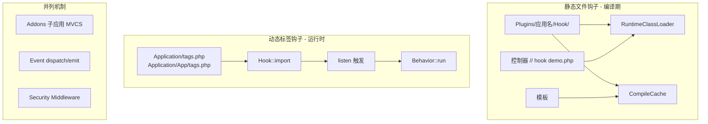
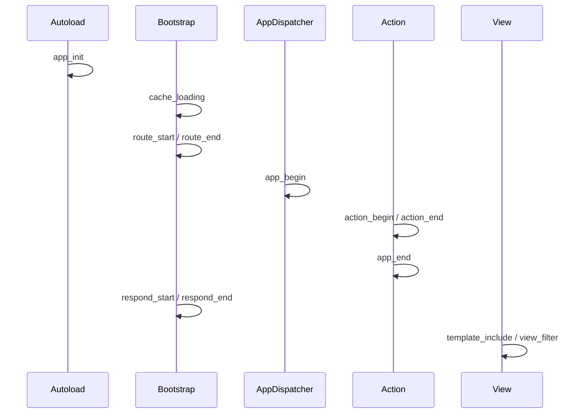

# Hook 钩子系统

> 最后修订：**2026-07-15**  
> 核心类：`Candy\Core\Hook`（`backend/Candy/Core/Hook.class.php`）  
> 标签速查：[Hook标签清单](Hook标签清单.md)

Candy 的扩展体系以 **`Hook` 类** 为中枢，同时提供两套可组合使用的机制：

1. **静态文件钩子**（Plugins + 编译期注入）——在控制器/模板编译产物中拼接片段  
2. **动态标签钩子**（Tags + Behaviors + `listen()`）——在请求生命周期运行时执行行为类

二者常与 **Addons（子应用）**、**Event（业务事件）**、**Middleware（HTTP 管道）** 配合使用，但职责不同，不宜混用。

---

## 1. 架构总览



### 1.1 机制对比

| 维度 | 静态钩子（Plugins） | 动态标签（Hook Tags） |
|------|---------------------|------------------------|
| 时机 | 编译写入 `Runtime/` | 每次请求 `listen()` |
| 配置 | `Source/Inc/Plug.inc.php` + `Plugins/*/conf.php` | `Application/tags.php`、`Application/{App}/tags.php` |
| 写法 | `// hook xxx.php`、`<!--{hook xxx.html}-->` | 行为类 `run()` 或闭包 |
| 典型用途 | 模板块、assign 片段 | 路由前、DB 后、输出过滤 |
| 核心 API | `Hook::processHook()` | `Hook::import()` / `listen()` |

---

## 2. Hook 类核心 API

| 方法 | 作用 |
|------|------|
| `getHooks()` / `getEnableHooks()` | 读取 `Plugins` 配置与启用状态 |
| `processHook($file)` / `processHookCallback()` | 合并已启用插件的 `Hook/` 文件内容 |
| `import($tags, $recursive)` | 批量注册「标签 → 行为列表」，并设置 `C('TAGS_XXX')` |
| `add($tag, $behavior, $first)` | 运行时追加单个行为 |
| `listen($tag, $params, $once)` | 按序执行标签下所有行为；`false` 中断；`$once` 取首个有效返回值 |
| `exec($class, $params)` | 直接执行单个行为 |
| `alias($name, $behavior)` | 行为别名 |
| `get($tag)` | 查看已注册行为 |
| `clearCache()` | 清空插件配置与标签缓存（改插件/标签后调用） |

全局函数 **`listen()`**（`Candy/Func/event.func.php`）是对 `Hook::listen` 的封装，但带有**门禁**：

```php
// 未 import 的标签不会执行，直接 return false
if (is_null(C('TAGS_'.strtoupper($tag)))) return false;
return \Candy\Core\Hook::listen($tag, $params, $once);
```

因此：**仅有框架埋点、未在 `tags.php` 注册时，`listen()` 为空操作。**

---

## 3. 静态文件钩子（Plugins）

### 3.1 目录与启用

```
Plugins/
└── {插件名}/          # 常与 Application 应用同名，如 Admin
    ├── conf.php       # name、version、enable、rank …
    └── Hook/
        ├── demo.php   # 控制器注入用
        └── demo.html  # 模板注入用
```

启用条件（`Hook::getEnableHooks()`）：

- `Source/Inc/Plug.inc.php` 中 `installed=1` 且 `enable=1`；或  
- 插件名等于当前应用 `RAPPNAME`（同名应用插件始终参与合并）

### 3.2 注入点

**控制器**（编译进 `Runtime/Controls/`）：

```php
function index(){
    //hook demo.php
    $this->display();
}
```

**模板**（编译进 `Runtime/Comps/`）：

```html
<!--{hook demo.html}-->
```

编译时由 `RuntimeClassLoader`、`CompileCache` 调用 `Hook::processHookCallback` 将各启用插件的同名校验文件内容**拼接**进产物（去除 `<?php exit;?>` 等保护头）。

### 3.3 千人千面（HALLMARK）

存在 `Plugins/{名}/Hook/demo_{HALLMARK}.php` 时优先于 `demo.php`，用于同一钩子按标识输出不同片段。

### 3.4 适用场景

- 往页面塞一块 HTML / 统计代码  
- 在控制器里统一 `assign` 变量  
- **不改核心源码** 的轻量扩展  

不适合：复杂业务编排、需 URL/权限的独立模块（请用 **Addon** 或正式 MVCS）。

---

## 4. 动态标签钩子（Tags / Behaviors）

### 4.1 注册入口

| 文件 | 加载时机 | 作用域 |
|------|----------|--------|
| [`Application/tags.php`](../../../Application/tags.php) | `Candy/Autoload.php` | 全局 |
| [`Application/{App}/tags.php`](../../../Application/Admin/tags.php) | `AppDispatcher::dispatch()` 前 | 当前应用 |

当前脚手架约定：

- **全局 `tags.php` 仅显式注册**，不自动扫描 `Candy/Vendor/*/tags.php`
- Apidoc / Catlog 用框架命令初始化：

```bash
php candy apidoc:init
php candy catlog:init
```

初始化后 `Application/tags.php` 形如：

```php
return \Catlog\Bootstrap::mergeTags(
    \Apidoc\Bootstrap::mergeTags([
        // 其它标签…
    ])
);
```

`enable=false` 或未发布 Inc 时对应 `hooks()` 为空，互不影响。Bootstrap/Installer 均在各自 Vendor 包内，**不**放 `Candy\Extend`。

### 4.2 行为类约定

```php
namespace APP\Extend\Behaviors;

class ApplySiteBrandLang
{
    /**
     * @param mixed $params 框架传入参数（多数标签为 null）
     * @return mixed 返回 false 可中断同标签后续行为
     */
    public function run($params = null): mixed
    {
        apply_site_brand_lang();
        return null;
    }
}
```

推荐路径：`Source/Class/Behaviors/`，命名空间 `APP\Extend\Behaviors`。

应用级注册示例（[`Application/Admin/tags.php`](../../../Application/Admin/tags.php)）：

```php
return [
    'app_begin' => [
        \APP\Extend\Behaviors\ApplySiteBrandLang::class,
    ],
];
```

### 4.3 请求生命周期（简图）



各标签触发位置、参数说明见 **[Hook标签清单](Hook标签清单.md)**。

---

## 5. 与 Addons / Event / Middleware 的分工

| 机制 | 路径/入口 | 配置 | 适用 |
|------|-----------|------|------|
| **Plugins 静态钩子** | `Plugins/` | `Plug.inc.php` | 编译期片段、同应用名扩展 |
| **Addons** | `Addons/` | `Addon.inc.php`，需 `G('Addons')` | 独立子应用（MVCS + 路由） |
| **Hook 标签** | `listen($tag)` | `tags.php` | 框架生命周期切面 |
| **Event** | `dispatch()` / `emit()` | `Event.inc.php` | 业务事件、通配符 `order.*` |
| **Middleware** | `Security::runMiddlewares()` | `Source/Middleware/` | 鉴权、限流、HTTP 过滤 |

### 选型口诀

| 需求 | 选择 |
|------|------|
| 独立菜单 / 路由 / 一套 MVCS | **Addon** |
| 现有页面塞 UI 片段、`assign` | **Plugin 静态 Hook** |
| 路由前、DB 写后、HTML 输出前插逻辑 | **Hook 标签** |
| 订单支付成功、用户登录等领域通知 | **Event** |
| 每个请求先过安检 | **Middleware** |

---

## 6. 扩展开发指引

### 6.1 Plugin 开发流程

1. 在 `Plugins/{名}/conf.php` 声明元数据  
2. `Source/Inc/Plug.inc.php` 中安装并 `enable=1`  
3. 在 `Hook/` 下放置片段，在控制器/模板写上 `hook` 标记  
4. 修改后清理 Runtime 编译缓存（见 [AGENTS.md](../../../AGENTS.md) Runtime 规则）

创建应用时 `Build::start` 会为 `RAPPNAME` 同步创建 `Plugins/{应用名}/Hook/` 骨架。

### 6.2 Addon 开发流程

1. 目录：`Addons/{名}/`（`Controls`、`Views`、`route.php`、`conf.php`）  
2. `Source/Inc/Addon.inc.php` 启用，全局配置开启 `G('Addons')`  
3. 访问与调用：`A('Addon://插件/操作')`  
4. 命名空间：`APP\Addon\{名}\*Action`

详见 [插件使用](插件使用.md) 中与 Addon 相关章节。

### 6.3 动态标签开发流程

1. 在 [Hook标签清单](Hook标签清单.md) 选定生命周期标签  
2. 编写 `APP\Extend\Behaviors\*` 的 `run()` 方法  
3. 写入 `Application/tags.php` 或 `Application/{App}/tags.php`  
4. 变更后：`Hook::clearCache()` 或 `php candy clear -c`

### 6.4 不建议做法

| 做法 | 原因 |
|------|------|
| 在 Service/Model 里直接改核心 `Hook.class.php` | 升级困难；优先用 `tags.php` 或 Plugin |
| 用 Hook 标签做重业务编排 | 与 Event、Service 职责重叠，难测试 |
| 控制器业务方法命名为 `init()` | 与 `Action::working()` 生命周期冲突 |
| 未 `import` 却依赖 `listen()` 生效 | 门禁导致静默不执行 |

---

## 7. 注意事项

### 7.1 CLI 与 `TAGS_*` 常量

`Candy/Autoload.php` 在 CLI 模式下会执行 `C(null, null)` 重置线程配置，**`C('TAGS_XXX')` 可能被清空**，但 `Hook::$tags` 静态数组仍保留。Web 请求下 `TAGS_*` 与行为列表一致；CLI 脚本若依赖 `listen()`，需注意此差异。

### 7.2 插件排序

多插件合并同一 `Hook/` 文件名时，顺序由 `conf.php` 的 **`rank`**（越小越靠前）与 `Plug.inc.php` 配置共同决定。

### 7.3 与 Node 权限的关系

`#[Annotation]` 供 **Node** 扫描菜单/权限；**Apidoc** 使用 `@Title` / `#[Title]` 等，二者可同方法并存。Hook 标签不参与 RBAC，权限仍由 `Common::init()` + Node 处理。

---

## 8. 相关文档

| 文档 | 内容 |
|------|------|
| [Hook标签清单](Hook标签清单.md) | 全部内置标签、参数、仓库当前注册情况 |
| [插件使用](插件使用.md) | Plugins 类扩展、编译合并细节 |
| [事件功能](事件功能.md) | Event 与 Hook 的区别 |
| [中间件使用](中间件使用.md) | Security 管道阶段 |
| [扩展使用](扩展使用.md) | `Source/Class`（`APP\Extend`） |

---

返回：[框架使用索引](README.md) · [总索引](../README.md)
