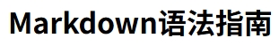

# Bootstrap5 使用指南

## 1. 信息提示框

Candy 框架支持使用 `::` 语法创建 Bootstrap5 风格的信息提示框（Alert），支持多种类型和可关闭功能。

### 1.1 基本用法
使用 `::` 后跟提示类型来创建信息提示框：

```markdown
#成功提示
\:: success
这是一个成功提示框。
\::
#信息提示
\:: info
这是一个信息提示框。
\::
#警告提示
\:: warning
这是一个警告提示框。
\::
#危险提示
\:: danger
这是一个危险提示框。
\::
```

:: success
这是一个成功提示框。
::

:: info
这是一个信息提示框。
::

:: warning
这是一个警告提示框。
::

:: danger
这是一个危险提示框。
::

### 1.2 支持的提示框类型

- `primary` - 主要提示
- `secondary` - 次要提示
- `success` - 成功提示
- `danger` - 危险/错误提示
- `warning` - 警告提示
- `info` - 信息提示
- `light` - 浅色提示
- `dark` - 深色提示

```markdown
\:: primary
这是主要提示框
\::
\:: secondary
这是次要提示框
\::
\:: light
这是浅色提示框
\::
\:: dark
这是深色提示框
\::
```

:: primary
这是主要提示框
::

:: secondary
这是次要提示框
::

:: light
这是浅色提示框
::

:: dark
这是深色提示框
::

### 1.3 带有关闭按钮的提示框

为提示框添加 `.alert-dismissible` 类和关闭按钮：

```markdown
\:: success {.alert-dismissible .fade .show}
=[]{.btn-close data-bs-dismiss="alert"}
这是一条可以关闭的成功提示信息！
\::
```
:: success {.alert-dismissible .fade .show}
=[]{.btn-close data-bs-dismiss="alert"}
这是一条可以关闭的成功提示信息！
::

### 1.4 提示框中包含链接

可以在提示框中添加链接，使用Markdown的链接语法即可：

```markdown
\:: info
这是一个包含[链接](https://example.com)的信息提示框。
\::
```

:: info
这是一个包含[链接](https://example.com)的信息提示框。
::

### 1.5 提示框中包含标题

可以在提示框中使用标题，增强信息的层次感：

```markdown
\:: warning
## 警告标题
这是一个包含标题的警告提示框。
\::
```

:: warning
## 警告标题
这是一个包含标题的警告提示框。
::

### 1.6 提示框中包含列表

可以在提示框中添加有序或无序列表：

```markdown
\:: success
成功完成以下操作：
1. 步骤一：数据导入
2. 步骤二：数据处理
3. 步骤三：结果生成
\::
```

:: success
成功完成以下操作：
1. 步骤一：数据导入
2. 步骤二：数据处理
3. 步骤三：结果生成
::

### 1.7 自定义样式的提示框

可以通过添加自定义类来自定义提示框的样式：

```markdown
:: primary {.custom-alert}
这是一个带有自定义类的提示框。
::
```

:: primary {.custom-alert}
这是一个带有自定义类的提示框。
::

## 2. Bootstrap5 按钮

Candy 框架支持使用 `\=\[` 语法创建 Bootstrap5 风格的按钮，支持自定义属性和样式。

### 2.1 基本用法

```markdown
=[按钮文本]
```

=[普通按钮]

### 2.2 添加 Bootstrap5 按钮

可以通过添加 Bootstrap5 的按钮类来自定义按钮样式：

```markdown
=[成功按钮]{.btn.btn-success}
=[主要按钮]{.btn.btn-primary}
=[次要按钮]{.btn.btn-secondary}
=[警告按钮]{.btn.btn-warning}
=[危险按钮]{.btn.btn-danger}
=[信息按钮]{.btn.btn-info}
=[浅色按钮]{.btn.btn-light}
=[深色按钮]{.btn.btn-dark}
=[链接按钮]{.btn.btn-link}
```

=[成功按钮]{.btn.btn-success}  
=[主要按钮]{.btn.btn-primary}  
=[次要按钮]{.btn.btn-secondary}  
=[警告按钮]{.btn.btn-warning}  
=[危险按钮]{.btn.btn-danger}  
=[信息按钮]{.btn.btn-info}  
=[浅色按钮]{.btn.btn-light}  
=[深色按钮]{.btn.btn-dark}  
=[链接按钮]{.btn.btn-link}  

### 2.3 按钮大小

```markdown
=[大按钮]{.btn.btn-primary.btn-lg}
=[普通按钮]{.btn.btn-primary}
=[小按钮]{.btn.btn-primary.btn-sm}
```

=[大按钮]{.btn.btn-primary.btn-lg}  
=[普通按钮]{.btn.btn-primary}  
=[小按钮]{.btn.btn-primary.btn-sm}

### 2.4 块级按钮

```markdown
=[块级按钮]{.btn.btn-primary.btn-block}
```

=[块级按钮]{.btn.btn-primary.btn-block}

### 2.5 禁用按钮

```markdown
=[禁用按钮]{.btn.btn-primary.disabled}
=[禁用按钮]{.btn.btn-primary.disabled="true"}
```

=[禁用按钮]{.btn.btn-primary.disabled}  
=[禁用按钮]{.btn.btn-primary.disabled="true"}

### 2.6 按钮组

可以使用 Bootstrap5 的按钮组组件：

```markdown
\>: {#container .btn-group role="group"}
  =[按钮1]{.btn.btn-primary}
  =[按钮2]{.btn.btn-primary}
  =[按钮3]{.btn.btn-primary}
\>!:
```

>: {#container .btn-group role="group"}
  =[按钮1]{.btn.btn-primary}
  =[按钮2]{.btn.btn-primary}
  =[按钮3]{.btn.btn-primary}
>!:

## 3. div布局

Candy 框架支持使用简洁的语法创建嵌套的 div 布局容器，方便进行页面布局和样式控制。

### 3.1 基本语法

使用 `>:` 作为开始标记，`>!:` 作为结束标记来创建 div 容器：

```markdown
\>: {#container .container style="background: #f5f5f5; padding: 20px;"}
这是 div 容器的内容
\>!:
```

>: {#container .container style="background: #f5f5f5; padding: 20px;"}
这是 div 容器的内容
>!:

### 3.2 属性设置

支持通过 `{}` 语法设置 div 的属性，包括：
- ID: `#container`
- Class: `.class1.class2`
- Style: `style="color: red;"`
- 自定义属性: `data-custom="value"`

```markdown
\>: {#main-content .content-wrapper style="max-width: 1200px; margin: 0 auto; background: #f5f5f5;"}
这是一个带有 ID、类和样式的 div 容器
\>!:
```

>: {#main-content .content-wrapper style="max-width: 1200px; margin: 0 auto; background: #f5f5f5;"}
这是一个带有 ID、类和样式的 div 容器
>!:

### 3.3 嵌套布局

通过增加冒号的数量来表示嵌套层级（`>::` 表示二级，`>:::` 表示三级，以此类推）：

```markdown
\>: {#outer .outer-container style="background: #f5f5f5; padding: 20px;"}
这是外层容器
\>:: {#inner1 .inner-container style="background: #e9ecef; padding: 20px;"}
这是内层容器 1
\>::: {.deep-inner style="background: #57718bff; padding: 20px;"}
这是更深层的容器
\>::
\>:: {#inner2 .inner-container style="background: #5a636bff; padding: 20px;"}
这是内层容器 2
\>!:
```

>: {#outer .outer-container style="background: #f5f5f5; padding: 20px;"}
这是外层容器
>:: {#inner1 .inner-container style="background: #e9ecef; padding: 20px;"}
这是内层容器 1
>::: {.deep-inner style="background: #57718bff; padding: 20px;"}
这是更深层的容器
>::
>:: {#inner2 .inner-container style="background: #5a636bff; padding: 20px;"}
这是内层容器 2
>!:

### 3.4 内部内容解析

div 容器内部支持完整的 Markdown 语法解析，包括标题、列表、链接等：

```markdown
\>: {.markdown-content}
# 这是标题

- 列表项 1
- 列表项 2

**粗体文本** 和 *斜体文本*

[链接](https://example.com)
\>!:
```

>: {.markdown-content}
# 这是标题

- 列表项 1
- 列表项 2

**粗体文本** 和 *斜体文本*

[链接](https://example.com)
>!:

### 3.5 实际应用示例

结合 Bootstrap 类创建响应式布局：

```markdown
\>: {.row}
\>:: {.col-md-6}
左侧内容列
\>:: {.col-md-6}
右侧内容列
\>!:
```

>: {.row}
>:: {.col-md-6}
左侧内容列
>:: {.col-md-6}
右侧内容列
>!:

### 3.6 创建按钮组：

```markdown
\>: {.btn-group role="group"}
  =[按钮1]{.btn.btn-primary}
  =[按钮2]{.btn.btn-primary}
  =[按钮3]{.btn.btn-primary}
\>!:
```

>: {.btn-group role="group"}
  =[按钮1]{.btn.btn-primary}
  =[按钮2]{.btn.btn-primary}
  =[按钮3]{.btn.btn-primary}
>!:

## 4. 徽章

### 4.1 基础语法  
```markdown
!badge[标签文本]
```
!badge[标签文本]

### 4.2 带颜色和形状

```markdown
!badge[主要标签](primary)  
!badge[成功标签](success)  
!badge[警告标签](warning)  
!badge[危险标签](danger)  
!badge[药丸标签](pill)  
```

!badge[主要标签](primary)  
!badge[成功标签](success)  
!badge[警告标签](warning)  
!badge[危险标签](danger)  
!badge[药丸标签](pill)  

### 4.3 带链接和自定义类

```markdown
!badge[链接标签](primary https://example.com)  
!badge[自定义标签](primary custom-class)
```

!badge[链接标签](primary https://example.com)  
!badge[自定义标签](primary custom-class)

## 5. 卡片
Bootstrap 5 卡片（Card）组件 是一种强大且灵活的容器，用于展示各种内容，如文本、图片、列表、按钮等。
卡片组件在 Bootstrap 5 中得到了改进和增强，提供了更多的定制选项和更灵活的布局方式。
卡片组件在 UI 设计中非常常见，尤其适用于博客、社交媒体、仪表盘和其他内容展示页面。

Bootstrap 5 的卡片组件包括以下常用元素：
 - .card：卡片的最外层容器。
 - .card-body：卡片的主要内容区域。
 - .card-title：卡片的标题部分。
 - .card-text：卡片的文本部分。
 - .card-img-top 或 .card-img-bottom：卡片顶部或底部的图片。

 
| 类名 | 说明 | 示例用法 |
| --- | --- | --- |
| .card	| 卡片的容器类，用于包装整个卡片。	| &lt;div class=&quot;card&quot;&gt;...&lt;/div&gt; |
| .card-body	| 包含卡片内容的容器，通常用于放置文本、标题等。	| &lt;div class=&quot;card-body&quot;&gt;...&lt;/div&gt; |
| .card-title	| 卡片标题类，通常包含卡片的主要标题。	| &lt;h5 class=&quot;card-title&quot;&gt;Card Title&lt;/h5&gt; |
| .card-text	| 卡片文本类，通常包含卡片的正文内容。	| &lt;p class=&quot;card-text&quot;&gt;Some quick example text...&lt;/p&gt; |
| .card-img-top	| 卡片顶部的图片类，通常用于展示卡片顶部的图像。	| &lt;img src=&quot;image.jpg&quot; class=&quot;card-img-top&quot;&gt; |
| .card-img-bottom	| 卡片底部的图片类，通常用于展示卡片底部的图像。	| &lt;img src=&quot;image.jpg&quot; class=&quot;card-img-bottom&quot;&gt; |
| .card-header	| 卡片的头部区域，用于放置标题或其他内容。	| &lt;div class=&quot;card-header&quot;&gt;Card Header&lt;/div&gt; |
| .card-footer	| 卡片的底部区域，用于放置额外的信息或操作按钮等。	| &lt;div class=&quot;card-footer&quot;&gt;Card Footer&lt;/div&gt; |
| .card-link	| 用于在卡片中创建链接。	| &lt;a href=&quot;#&quot; class=&quot;card-link&quot;&gt;Card link&lt;/a&gt; |
| .card-deck	| 在 Bootstrap 5 中已被废弃，使用 row 和 col 代替。	| &lt;div class=&quot;card-deck&quot;&gt;...&lt;/div&gt; |
| .card-group	| 在 Bootstrap 5 中已被废弃，使用 row 和 col 代替。	| &lt;div class=&quot;card-group&quot;&gt;...&lt;/div&gt; |
| .card-columns	| 使用多列布局，卡片按照流式布局排列。	| &lt;div class=&quot;card-columns&quot;&gt;...&lt;/div&gt; |
| .card-subtitle	| 卡片的副标题，通常显示在标题下方。	| &lt;h6 class=&quot;card-subtitle mb-2 text-muted&quot;&gt;Card subtitle&lt;/h6&gt; |
| .card-img-overlay	| 在卡片图片上叠加内容层，常用于显示文本或其他元素。	| &lt;div class=&quot;card-img-overlay&quot;&gt;Overlay content&lt;/div&gt; |

### 5.1 简单的卡片
```markdown
\>: {.card}
  \>:: {.card-body}
  简单的卡片
\>!:
```

>: {.card}
  >:: {.card-body}
  简单的卡片
>!:

### 5.2 头部和底部
`.card-header`类用于创建卡片的头部样式， `.card-footer` 类用于创建卡片的底部样式：

```markdown
\>: {.card}
  \>:: {.card-header}
  卡片头部
  \>:: {.card-body}
  简单的卡片
  \>:: {.card-footer}
  卡片底部
\>!:
```

>: {.card}
  >:: {.card-header}
  卡片头部
  >:: {.card-body}
  简单的卡片
  >:: {.card-footer}
  卡片底部
>!:

### 5.3 多种颜色卡片
提供了多种卡片的背景颜色类： `.bg-primary`, `.bg-success`, `.bg-info`, `.bg-warning`, `.bg-danger`, `.bg-secondary`, `.bg-dark` 和 `.bg-light`。

>: {.container}
## 多种颜色卡片
  >:: {.card}
    >::: {.card-body}
    基础卡片
  >::
  >:: {.card .bg-primary .text-white}
    >::: {.card-body}
    主要卡片
  >::
  >:: {.card .bg-success .text-white}
    >::: {.card-body}
    成功卡片
  >::
  >:: {.card .bg-info .text-white}
    >::: {.card-body}
    信息卡片
  >::
  >:: {.card .bg-warning .text-white}
    >::: {.card-body}
    警告卡片
  >::
  >:: {.card .bg-danger .text-white}
    >::: {.card-body}
    危险卡片
  >::
  >:: {.card .bg-secondary .text-white}
    >::: {.card-body}
    次要卡片
  >::
  >:: {.card .bg-dark .text-white}
    >::: {.card-body}
    黑色卡片
  >::
  >:: {.card .bg-light .text-dark}
    >::: {.card-body}
    浅色卡片
  >::
>!:

### 5.4 标题、文本和链接
我们可以在头部元素上使用 `.card-title` 类来设置卡片的标题 。 `.card-body` 类用于设置卡片正文的内容。`.card-text` 类用于设置卡 `.card-body` 类中的 `<p>` 标签，如果说最后一行可以移除底部边距。 `.card-link` 类用于给链接设置颜色。

```markdown
\>: {.card}
  \>:: {.card-body}
#### Card title
    [[Some example text. Some example text.]] {.card-text}
    [Card link](#){.card-link}
    [Another link](#){.card-link}
  >::
\>!:
```

>: {.card}
  >:: {.card-body}
#### Card title
    [[Some example text. Some example text.]] {.card-text}
    [Card link](#){.card-link}
    [Another link](#){.card-link}
  >::
>!:

### 5.5 图片卡片
我们可以给 `` 添加 `.card-img-top`（图片在文字上方） 或 `.card-img-bottom`（图片在文字下方） 类来设置图片卡片：

```markdown
\>: {.card style="width:400px"}
   {.card-img-top}
  \>:: {.card-body}
#### John Doe {.card-title}
  [[Some example text.]]{.card-text}
  [See Profile](#){.btn.btn-primary}
\>!:
```

>: {.card style="width:400px"}
   {.card-img-top}
  >:: {.card-body}
#### John Doe {.card-title}
  [[Some example text.]]{.card-text}
  [See Profile](#){.btn.btn-primary}
>!:

## 6. 下拉菜单
下拉菜单是可切换的，是以列表格式显示链接的上下文菜单。

### 6.1 应用示例

>: {.dropdown}
  =[下拉菜单按钮]{.btn .btn-primary .dropdown-toggle data-bs-toggle="dropdown"}
  >:: {.dropdown-menu}
  [链接 1](#){.dropdown-item}
  [链接 2](#){.dropdown-item}
  [链接 3](#){.dropdown-item}
>!:

#### 实例解析
.dropdown 类用来指定一个下拉菜单。
我们可以使用一个按钮或链接来打开下拉菜单， 按钮或链接需要添加 `.dropdown-toggle` 和 `data-toggle="dropdown"` 属性。
元素上添加 `.dropdown-menu` 类来设置实际下拉菜单，然后在下拉菜单的选项中添加 `.dropdown-item` 类。

### 6.2 下拉菜单中的分割线
`.dropdown-header` 类用于在下拉菜单中添加标题：

```markdown
--- {.dropdown-divider}
```

>: {.dropdown}
  =[下拉菜单按钮]{.btn .btn-primary .dropdown-toggle data-bs-toggle="dropdown"}
  >:: {.dropdown-menu}
  [链接 1](#){.dropdown-item}
  [链接 2](#){.dropdown-item}
--- {.dropdown-divider}
  [链接 3](#){.dropdown-item}
>!:

### 6.3 下拉菜单中的标题
`.dropdown-header` 类用于在下拉菜单中添加标题：


>: {.dropdown}
  =[下拉菜单按钮]{.btn .btn-primary .dropdown-toggle data-bs-toggle="dropdown"}
  >:: {.dropdown-menu}
###### 标题5
  [链接 2](#){.dropdown-item}
  [链接 3](#){.dropdown-item}
>!:

### 6.4 下拉菜单中的可用项与禁用项
`.active` 类会让下拉菜单的选项高亮显示 (添加蓝色背景)。
如果要禁用下拉菜单的选项，可以使用`.disabled` 类。


>: {.dropdown}
  =[下拉菜单按钮]{.btn .btn-primary .dropdown-toggle data-bs-toggle="dropdown"}
  >:: {.dropdown-menu}
  [常规项](#){.dropdown-item}
  [激活项](#){.dropdown-item .active}
  [禁用项](#){.dropdown-item .disabled}
>!:

### 6.5 下拉菜单的定位
如果我们想让下拉菜单右对齐，可以在元素上的 .dropdown 类后添加 .dropend 或 .dropstart 类。

>: {.row}
#### 右对齐
  [[如果我们想让下拉菜单右对齐，可以在元素上的 .dropdown 类后添加 .dropend 类。]]
  >:: {.dropdown .dropend}
    =[下拉菜单按钮]{.btn .btn-primary .dropdown-toggle data-bs-toggle="dropdown"}
    >::: {.dropdown-menu}
    [链接 1](#){.dropdown-item}
    [链接 2](#){.dropdown-item}
    [链接 3](#){.dropdown-item}
>!:

>: {.row}
#### 左对齐
  [[如果我们想让下拉菜单左边对齐，可以在元素上的 .dropdown 类后添加 .dropstart 类，同时我们将整个下拉菜单向右浮动。]]
  >:: {.dropdown .dropstart .text-end}
    =[下拉菜单按钮]{.btn .btn-primary .dropdown-toggle data-bs-toggle="dropdown" style="float:right"}
    >::: {.dropdown-menu}
    [链接 1](#){.dropdown-item}
    [链接 2](#){.dropdown-item}
    [链接 3](#){.dropdown-item}
>!:


### 6.6 下拉菜单弹出方向设置
下拉菜单弹出方向默认为向下，当然我们也可以设置不同的方向。

#### 6.6.1 指定向右弹出的下拉菜单
如果你希望下拉菜单向右下方弹出，可以在 div 元素上添加 `.dropdown-menu-end` 类:

>: {.dropdown .dropdown-menu-end}
  =[下拉菜单右下方弹出]{.btn .btn-primary .dropdown-toggle data-bs-toggle="dropdown"}
  >:: {.dropdown-menu}
    [链接 1](#){.dropdown-item}
    [链接 2](#){.dropdown-item}
    [链接 3](#){.dropdown-item}
>!:

#### 6.6.2 指定向上弹出的上拉菜单
如果你希望上拉菜单向上弹出，可以在 div 元素上添加 `dropup` 类:

>: {.dropup}
  =[下拉菜单右下方弹出]{.btn .btn-primary .dropdown-toggle data-bs-toggle="dropdown"}
  >:: {.dropdown-menu}
    [链接 1](#){.dropdown-item}
    [链接 2](#){.dropdown-item}
    [链接 3](#){.dropdown-item}
>!:

#### 6.6.3 指定向左边弹出的下拉菜单
如果你希望下拉菜单向上弹出，可以在 div 元素上添加 `dropstart` 类:

>: {.dropstart}
  =[下拉菜单右下方弹出]{.btn .btn-primary .dropdown-toggle data-bs-toggle="dropdown" style="float:right"}
  >:: {.dropdown-menu}
    [链接 1](#){.dropdown-item}
    [链接 2](#){.dropdown-item}
    [链接 3](#){.dropdown-item}
>!:

#### 6.6.4 下拉菜单设置文本
`.dropdown-item-text` 类可以设置下拉菜单中的文本项：

>: {.dropup}
  =[下拉菜单右下方弹出]{.btn .btn-primary .dropdown-toggle data-bs-toggle="dropdown"}
  >:: {.dropdown-menu}
    [链接 1](#){.dropdown-item}
    [链接 2](#){.dropdown-item}
    [[[仅仅是文本]]]{.dropdown-item-text}
>!:

#### 6.6.5 按钮组中设置下拉菜单
我们可以在按钮中添加下拉菜单：

>: {.btn-group}
  =[Apple]{.btn .btn-primary}
  =[Samsung]{.btn .btn-primary}
  >:: {.btn-group}
    =[Sony]{.btn .btn-primary .dropdown-toggle data-bs-toggle="dropdown"}
    >::: {.dropdown-menu}
      =[Tablet]{.dropdown-item}
      =[Smartphone]{.dropdown-item}
>!:

### 6.7 折叠
Bootstrap5 折叠可以很容易的实现内容的显示与隐藏。

#### 6.7.1 折叠组件的基本属性
`data-bs-toggle="collapse"` 和 `data-bs-target` 是用于定义组件行为和目标元素的自定义数据属性。

  1. `data-bs-toggle` 属性：
    - 用于定义组件的行为，指示组件在何时触发。
    - 可以设置的值取决于具体的组件类型，如 "collapse"（折叠菜单）、"modal"（模态框）、"tab"（标签页）等。
    - data-bs-toggle="collapse" 用于触发折叠菜单的展开与折叠。
    - data-bs-toggle="modal" 用于触发模态框的显示与隐藏。
    - data-bs-toggle="tab" 用于触发标签页的切换。
  1. `data-bs-target` 属性：
    - 用于指定组件的目标元素或目标选择器。
    - 目标元素可以是一个 CSS 选择器，用于标识要操作的具体元素。
    - 也可以是一个指定的元素 ID，以 # 开头，如 data-bs-target="#myModal"。
    - data-bs-target 属性与 data-bs-toggle 属性一起使用，用于将组件行为与目标元素关联起来。

#### 6.7.2 基本用法
当按钮被点击时，data-bs-toggle="collapse" 属性触发了折叠菜单的行为，data-bs-target="#demo" 属性指定了折叠菜单的目标元素为 ID 为 demo 的 &lt;div&gt; 元素。

```markdown
\>: {.container .mt-3}
## 简单的折叠
  [[点击按钮内容会再显示与隐藏之间切换。]]
  =[折叠]{.btn .btn-primary data-bs-toggle="collapse" data-bs-target="#demo"}
  \>:: {#demo .collapse}
    这里是一些测试的内容。。。这里是一些测试的内容。。。这里是一些测试的内容。。。这里是一些测试的内容。。。这里是一些测试的内容。。。
\>!:
```

#### 6.7.3 用a链接绑定事件

`.collapse` 类用于指定一个折叠元素 (实例中的&lt;div&gt;); 点击按钮后会在隐藏与显示之间切换。
控制内容的隐藏与显示，需要在&lt;a&gt; 或 &lt;button&gt; 元素上添加 `data-bs-toggle="collapse"` 属性。 `data-target="#id"` 属性是对应折叠的内容 (&lt;div id="demo"&gt;)。
注意: &lt;a&gt; 元素上你可以使用 `href` 属性来代替 `data-bs-target` 属性:

```markdown
\>: {.container .mt-3}
## 简单的折叠
  [[点击按钮内容会再显示与隐藏之间切换。]]
  [简单的折叠](#demo2){.btn .btn-primary data-bs-toggle="collapse"}
  \>:: {#demo2 .collapse}
    这里是一些测试的内容。。。这里是一些测试的内容。。。这里是一些测试的内容。。。这里是一些测试的内容。。。这里是一些测试的内容。。。
\>!:
```

默认情况下折叠的内容是隐藏的，你可以添加 .show 类让内容默认显示:

```markdown
\>: {#demo2 .collapse .show}
    这里是一些测试的内容。。。这里是一些测试的内容。。。这里是一些测试的内容。。。这里是一些测试的内容。。。这里是一些测试的内容。。。
\>!:
```

#### 6.7.4 手风琴样式

>: {.container .mt-3}
## 手风琴实例
  [[**注意：** 使用 **data-parent** 属性来确保所有的折叠元素在指定的父元素下，这样就能实现在一个折叠选项显示时其他选项就隐藏。]]
  >:: {#accordion }
    >::: {.card}
      >:::: {.card-header}
        [选项一](#collapseOne) {.btn data-bs-toggle="collapse"}
      >:::: {#collapseOne .collapse .show data-bs-parent="#accordion"}
        >::::: {.card-body}
          #1 内容：菜鸟教程 -- 学的不仅是技术，更是梦想！！！
        >:::::
      >::::
    >:::     
    >::: {.card}
      >:::: {.card-header}
        [选项二](#collapseTwo) {.btn .collapsed data-bs-toggle="collapse"}
      >:::: {#collapseTwo .collapse data-bs-parent="#accordion"}
        >::::: {.card-body}
          #2 内容：菜鸟教程 -- 学的不仅是技术，更是梦想！！！
        >:::::
      >::::
    >:::  
    >::: {.card}
      >:::: {.card-header}
        [选项三](#collapseThree) {.btn .collapsed data-bs-toggle="collapse"}
      >:::: {#collapseThree .collapse data-bs-parent="#accordion"}
        >::::: {.card-body}
          #3 内容：菜鸟教程 -- 学的不仅是技术，更是梦想！！！
        >:::::
      >::::
>!:

## 7. 导航
如果你想创建一个简单的水平导航栏，可以在 &lt;ul&gt; 元素上添加 `.nav` 类，在每个 &lt;li&gt; 选项上添加 `.nav-item` 类，在每个链接上添加 `.nav-link` 类:

### 7.1 基本应用

```markdown
- [Link](#){.nav-link} {{.nav-item}} {{.nav}}
- [Link](#){.nav-link}
- [Link](#){.nav-link}
- [Disabled](#){.nav-link .disabled}
```

- [Link](#){.nav-link} {{.nav-item}} {{.nav}}
- [Link](#){.nav-link}
- [Link](#){.nav-link}
- [Disabled](#){.nav-link .disabled}

### 7.2 导航对齐方式
`.justify-content-center` 类设置导航居中显示， `.justify-content-end` 类设置导航右对齐。

```markdown
## 导航居中
- [Link](#){.nav-link} {{.nav-item}} {{.nav .justify-content-center}}

## 导航右对齐
- [Link](#){.nav-link} {{.nav-item}} {{.nav .justify-content-end}}
```

#### 7.2.1 导航居中
- [Link](#){.nav-link} {{.nav-item}} {{.nav .justify-content-center}}
- [Link](#){.nav-link}
- [Disabled](#){.nav-link .disabled}

#### 7.2.1 导航右对齐
- [Link](#){.nav-link} {{.nav-item}} {{.nav .justify-content-end}}
- [Link](#){.nav-link}
- [Disabled](#){.nav-link .disabled}

### 7.3 垂直导航
`.flex-column` 类用于创建垂直导航：

```markdown
## 垂直导航
- [Link](#){.nav-link} {{.nav-item}} {{.nav .flex-column}}
```

- [Link](#){.nav-link} {{.nav-item}} {{.nav .flex-column}}
- [Link](#){.nav-link}
- [Disabled](#){.nav-link .disabled}

### 7.4 选项卡
使用 `.nav-tabs` 类可以将导航转化为选项卡。然后对于选中的选项使用 `.active` 类来标记。

```markdown
- [Link](#){.nav-link} {{.nav-item}} {{.nav .nav-tabs}}
- [Link](#){.nav-link .active}
- [Disabled](#){.nav-link .disabled}
```

- [Link](#){.nav-link} {{.nav-item}} {{.nav .nav-tabs}}
- [Link](#){.nav-link .active}
- [Disabled](#){.nav-link .disabled}

### 7.5 胶囊导航
`.nav-pills` 类可以将导航项设置成胶囊形状。

```markdown
- [Link](#){.nav-link} {{.nav-item}} {{.nav .nav-pills}}
- [Link](#){.nav-link .active}
- [Disabled](#){.nav-link .disabled}
```

- [Link](#){.nav-link} {{.nav-item}} {{.nav .nav-pills}}
- [Link](#){.nav-link .active}
- [Disabled](#){.nav-link .disabled}

### 7.6 导航等宽
`.nav-justified` 类可以设置导航项齐行等宽显示。

```markdown
- [Link](#){.nav-link} {{.nav-item}} {{.nav .nav-pills .nav-justified}}
- [Link](#){.nav-link .active}
- [Disabled](#){.nav-link .disabled}
```

- [Link](#){.nav-link} {{.nav-item}} {{.nav .nav-pills .nav-justified}}
- [Link](#){.nav-link .active}
- [Disabled](#){.nav-link .disabled}

### 7.7 动态选项卡
如果你要设置选项卡是动态可切换的，可以在每个链接上添加 `data-bs-toggle="tab"` 属性。 然后在每个选项对应的内容的上添加 `.tab-pane` 类，对应选项卡的内容的 `<div>` 标签使用 `.tab-content` 类 。

如果你希望有淡入效果可以在 `.tab-pane` 后添加 `.fade` 类:

修改 `.nav-tabs` 为 `.nav-pills` 就变成了胶囊动态选项卡

>: {.container .mt-3}
- [Home](#home) {.nav-link .active data-bs-toggle="tab"} {{.nav-item}} {{.nav .nav-tabs role="tablist"}}
- [Menu 1](#menu1) {.nav-link data-bs-toggle="tab"}
- [Menu 2](#menu2) {.nav-link data-bs-toggle="tab" }
  >:: {.tab-content}
    >::: {#home .tab-pane .active .containert}
### HOME
      [[Lorem ipsum dolor sit amet, consectetur adipisicing elit, sed do eiusmod tempor incididunt ut labore et dolore magna aliqua.]]
    >::: {#menu1 .tab-pane .fade .containert}
### Menu 1
      [[Lorem ipsum dolor sit amet, consectetur adipisicing elit, sed do eiusmod tempor incididunt ut labore et dolore magna aliqua.]]
    >::: {#menu2 .tab-pane .fade .containert}
### Menu 2
      [[Lorem ipsum dolor sit amet, consectetur adipisicing elit, sed do eiusmod tempor incididunt ut labore et dolore magna aliqua.]]
>!:

## 8. 导航栏
导航栏一般放在页面的顶部。
我们可以使用 `.navbar` 类来创建一个标准的导航栏，后面紧跟: `.navbar-expand-xxl|xl|lg|md|sm` 类来创建响应式的导航栏 (大屏幕水平铺开，小屏幕垂直堆叠)。

导航栏上的选项可以使用`<ul>`元素并添加 class="navbar-nav" 类。 然后在 `<li>` 元素上添加 .nav-item 类， `<a>` 元素上使用 `.nav-link` 类:

### 8.1 基本用法

>: nav {.navbar .navbar-expand-sm .bg-light} 
  - [Link 1](#) {.nav-link} {{.nav-item}} {{.navbar-nav}}
  - [Link 2](#) {.nav-link}
  - [Link 3](#) {.nav-link}
>!:

### 8.2 垂直导航栏
通过删除 `.navbar-expand-xxl|xl|lg|md|sm` 类来创建垂直导航栏:

>: nav {.navbar .bg-light} 
  - [Link 1](#) {.nav-link} {{.nav-item}} {{.navbar-nav}}
  - [Link 2](#) {.nav-link}
  - [Link 3](#) {.nav-link}
>!:

### 8.3 居中对齐的导航栏
通过添加 `.justify-content-center` 类来创建居中对齐的导航栏:

>: nav {.navbar .navbar-expand-sm .bg-light .justify-content-center} 
  - [Link 1](#) {.nav-link} {{.nav-item}} {{.navbar-nav}}
  - [Link 2](#) {.nav-link}
  - [Link 3](#) {.nav-link}
>!:

### 8.4 不同颜色导航栏
可以使用以下类来创建不同颜色导航栏：`.bg-primary`, `.bg-success`, `.bg-info`, `.bg-warning`, `.bg-danger`, `.bg-secondary`, `.bg-dark` 和 `.bg-light`。
提示: 对于暗色背景 `.navbar-dark` 需要设置文本颜色为浅色的，对于浅色背景 `.navbar-light` 需要设置文本颜色为深色的。

#### 8.4.1 灰底黑字
>: nav {.navbar .navbar-expand-sm .bg-light .navbar-light} 
  - [Link 1](#) {.nav-link} {{.nav-item}} {{.navbar-nav}}
  - [Link 2](#) {.nav-link}
  - [Link 3](#) {.nav-link}
>!:
#### 8.4.2 黑底白字
>: nav {.navbar .navbar-expand-sm .bg-dark .navbar-dark} 
  - [Link 1](#) {.nav-link} {{.nav-item}} {{.navbar-nav}}
  - [Link 2](#) {.nav-link}
  - [Link 3](#) {.nav-link}
>!:
#### 8.4.3 蓝底白字
>: nav {.navbar .navbar-expand-sm .bg-primary .navbar-dark} 
  - [Link 1](#) {.nav-link} {{.nav-item}} {{.navbar-nav}}
  - [Link 2](#) {.nav-link}
  - [Link 3](#) {.nav-link}
>!:

### 8.5 品牌/Logo
.navbar-brand 类用于高亮显示品牌/Logo 可以使用 .navbar-brand 类来设置图片自适应导航栏。

>: nav {.navbar .navbar-expand-sm .bg-primary .navbar-dark} 
  - [Link 1](#) {.navbar-brand} {{.nav-item}} {{.navbar-nav}}
  - [Link 2](#) {.nav-link}
  - [Link 3](#) {.nav-link}
>!:

### 8.6 导航栏的表单
导航栏的表单 `<form>` 元素使用 `class="form-inline"` 类来排版输入框与按钮：

你也可以使用其他的输入框类，如 `.input-group-addon` 类用于在输入框前添加小标签。

>: nav {.navbar .navbar-expand-sm .bg-light .navbar-light} 
  - [Link 1](#) {.nav-link} {{.nav-item}} {{.navbar-nav .me-auto}}
  - [Link 2](#) {.nav-link}
  - [Link 3](#) {.nav-link}

  #[]{.d-flex}
  >:: {.input-group}
    >::: {.input-group-prepend}
      [[[@]]]{.input-group-text}
  >::
  @[Search]{.form-control .me-2 type="text"}
  =[Search]{.btn .btn-primary}
  #[]
>!:

### 8.7 导航栏文本
使用 `.navbar-text` 类来设置导航栏上非链接文本，可以保证水平对齐，颜色与内边距一样。

>: nav {.navbar .navbar-expand-sm .bg-light .navbar-light} 
  - [Link 1](#) {.nav-link} {{.nav-item}} {{.navbar-nav}}
  - [Link 2](#) {.nav-link}
  - [Link 3](#) {.nav-link}

  [[[Navbar text]]]{.navbar-text}
>!:

### 8.8 固定导航栏
导航栏可以固定在头部或者底部。
我们使用 `.fixed-top` 类来实现导航栏的固定,
`.fixed-bottom` 类用于设置导航栏固定在底部：

```markdown
\>: nav {.navbar .navbar-expand-sm .bg-dark .navbar-dark .fixed-top} 
  - [Link 1](#) {.nav-link} {{.nav-item}} {{.navbar-nav}}
  - [Link 2](#) {.nav-link}
  - [Link 3](#) {.nav-link}

  [[[Navbar text]]]{.navbar-text}
\>!:
```

## 9. 轮播

在每个 `<div class="carousel-item">` 内添加 `<div class="carousel-caption">` 来设置轮播图片的描述文本：

```markdown
\>: {#demo .carousel .slide data-bs-ride="carousel"}
  \>:: {.carousel-indicators}
    =[]{.active data-bs-target="#demo" data-bs-slide-to="0" }
    =[]{data-bs-target="#demo" data-bs-slide-to="1" }
    =[]{data-bs-target="#demo" data-bs-slide-to="2" }
  
  \>:: {.carousel-inner}
    \>::: {.carousel-item .active}
      {.d-block style="width:100%"}
      >:::: {.carousel-caption}
### 第一张图片描述标题
        [[第一张图片描述内容显示在这里！！！]]
    \>::: {.carousel-item}
      {.d-block style="width:100%"}
    \>::: {.carousel-item .active}
      {.d-block style="width:100%"}

    \>::
      =[<]{.carousel-control-prev data-bs-target="#demo" data-bs-slide-to="prev" }
      =[>]{.carousel-control-next data-bs-target="#demo" data-bs-slide-to="next" }
\>!:
```

|类|描述|
|---|---|
|.carousel|创建一个轮播|
|.carousel-indicators|为轮播添加一个指示符，就是轮播图底下的一个个小点，轮播的过程可以显示目前是第几张图。|
|.carousel-inner|添加要切换的图片|
|.carousel-item|指定每个图片的内容|
|.carousel-control-prev|添加左侧的按钮，点击会返回上一张。|
|.carousel-control-next|添加右侧按钮，点击会切换到下一张。|
|.carousel-control-prev-icon|与 .carousel-control-prev 一起使用，设置左侧的按钮|
|.carousel-control-next-icon|与 .carousel-control-next 一起使用，设置右侧的按钮|
|.slide|切换图片的过渡和动画效果，如果你不需要这样的效果，可以删除这个类。|

## 10. 模态框
模态框（Modal）是覆盖在父窗体上的子窗体。通常，目的是显示来自一个单独的源的内容，可以在不离开父窗体的情况下有一些互动。子窗体可提供信息交互等。

```markdown
=[打开模态框]{.btn .btn-primary data-bs-toggle="modal" data-bs-target="#myModal"}
\>: {#myModal .modal}
  \>:: {.modal-dialog}
    \>::: {.modal-content}
      \>:::: {.modal-header}
#### 模态框标题
        =[]{.btn-close data-bs-dismiss="modal"}

      \>:::: {.modal-body}
        模态框内容..
      
      \>:::: {.modal-footer}
        =[关闭]{.btn .btn-danger data-bs-dismiss="modal"}
\>!:
```

=[打开模态框]{.btn .btn-primary data-bs-toggle="modal" data-bs-target="#myModal"}
>: {#myModal .modal}
  >:: {.modal-dialog}
    >::: {.modal-content}
      >:::: {.modal-header}
#### 模态框标题
        =[]{.btn-close data-bs-dismiss="modal"}

      >:::: {.modal-body}
        模态框内容..
      
      >:::: {.modal-footer}
        =[关闭]{.btn .btn-danger data-bs-dismiss="modal"}
>!:

### 模态框尺寸
我们可以通过添加 `.modal-sm` 类来创建一个小模态框，`.modal-lg` 类可以创建一个大模态框。
尺寸类放在 `<div>` 元素的 `.modal-dialog` 类后 :

```markdown
## 小模态框
\>:: {.modal-dialog .modal-sm}
## 大模态框
\>:: {.modal-dialog .modal-lg}
## 超大模态框
\>:: {.modal-dialog .modal-xl}
## 全屏幕显示
\>:: {.modal-dialog .modal-fullscreen}
## 模态框居中显示
\>:: {.modal-dialog .modal-dialog-centered}
## 模态框里头设置一个滚动条
\>:: {.modal-dialog .modal-dialog-scrollable}
```
使用 .modal-fullscreen-*-* 类可以控制在什么尺寸下全屏幕显示:

|类|描述|
|---|---|
|.modal-fullscreen-sm-down|576px 以下尺寸全屏幕显示|
|.modal-fullscreen-md-down|768px 以下尺寸全屏幕显示|
|.modal-fullscreen-lg-down|992px 以下尺寸全屏幕显示|
|.modal-fullscreen-xl-down|1200px 以下尺寸全屏幕显示|
|.modal-fullscreen-xxl-down|1400px 以下尺寸全屏幕显示|

## 11. 提示框
提示框是一个小小的弹窗，在鼠标移动到元素上显示，鼠标移到元素外就消失。

>: {.container .mt-3}
### 提示框实例
  =[鼠标移动到我这]{.btn .btn-primary data-bs-toggle="tooltip" title="我是提示内容!"}
>!:

### 默认情况下提示框显示在元素上方。
可以使用 `data-bs-placement` 属性来设定提示框显示的方向: top, bottom, left 或 right:

```markdown
## 默认顶部
=[鼠标移动到我这]{.btn .btn-primary data-bs-toggle="tooltip" title="我是提示内容!"}
## 底部
=[鼠标移动到我这]{.btn .btn-primary data-bs-toggle="tooltip" title="我是提示内容!" data-bs-placement="bottom"}
## 左侧
=[鼠标移动到我这]{.btn .btn-primary data-bs-toggle="tooltip" title="我是提示内容!" data-bs-placement="left"}
## 右侧
=[鼠标移动到我这]{.btn .btn-primary data-bs-toggle="tooltip" title="我是提示内容!" data-bs-placement="right"}
```

+++js
// 初始化提示框
var tooltipTriggerList = [].slice.call(document.querySelectorAll('[data-bs-toggle="tooltip"]'))
var tooltipList = tooltipTriggerList.map(function (tooltipTriggerEl) {
  return new bootstrap.Tooltip(tooltipTriggerEl)
})
+++

## 12. 弹出框

通过向元素添加 `data-bs-toggle="popover"` 来创建弹出框。
`title` 属性的内容为弹出框的标题，`data-bs-content` 属性显示了弹出框的文本内容：

默认情况下，弹出框在再次点击指定元素后就会关闭，你可以使用 `data-bs-trigger="focus"` 属性来设置在鼠标点击元素外部区域来关闭弹出框。

如果你想实现在鼠标移动到元素上显示，移除后消失的效果，可以使用 `data-bs-trigger` 属性，并设置值为 `hover`:

>: {.container .mt-3}
### 弹出框实例
  =[多次点我]{.btn .btn-primary data-bs-toggle="popover" data-bs-trigger="focus" title="弹出框标题" data-bs-content="弹出框内容"}
>!:

默认情况下弹出框显示在元素右侧。
可以使用 `data-bs-placement` 属性来设定弹出框显示的方向: top, bottom, left 或 right:

```markdown
## 顶部
=[点我]{.btn .btn-primary data-bs-toggle="popover" data-bs-placement="top" title="弹出框标题" data-bs-content="弹出框内容"}
## 底部
=[点我]{.btn .btn-primary data-bs-toggle="popover" data-bs-placement="bottom" title="弹出框标题" data-bs-content="弹出框内容"}
## 左侧
=[点我]{.btn .btn-primary data-bs-toggle="popover" data-bs-placement="left" title="弹出框标题" data-bs-content="弹出框内容"}
## 默认右侧
=[点我]{.btn .btn-primary data-bs-toggle="popover" title="弹出框标题" data-bs-content="弹出框内容"}
```

+++js
var popoverTriggerList = [].slice.call(document.querySelectorAll('[data-bs-toggle="popover"]'))
var popoverList = popoverTriggerList.map(function (popoverTriggerEl) {
  return new bootstrap.Popover(popoverTriggerEl)
})
+++

## 13. 消息弹窗
Bootstrap5 弹窗 (Toasts) 是一种轻量级的通知组件，用于在页面的角落或底部显示临时性的信息、通知或警告。

弹窗通常用于向用户显示短期消息，比如成功消息、错误消息、警告或其他通知。

弹窗可以在页面的不同位置显示，包括左上角、右上角、左下角、右下角以及页面底部中央。

>: {.container .mt-3}
### 弹窗实例
  [[弹窗通常用于向用户显示短期消息，比如成功消息、错误消息、警告或其他通知。。]]
  [[在这个页面的实例中我们使用 .show 来设置显示弹窗，可以点击关闭（X）图标来关闭弹窗。]]
  [[关闭后我们通过点击按钮来显示弹窗。]]
  =[显示弹窗]{#toastbtn .btn .btn-primary"}
  >:: {.toast .show}
    >::: {.toast-header}
      >:::: {.me-auto}
        **弹窗标题**
      >::::
      =[]{.btn-close data-bs-dismiss="toast"}
    >:::
    >::: {.toast-body}
      [[这是一个Bootstrap 5弹窗示例。]]
>!:

+++js
document.getElementById("toastbtn").onclick = function() {
  var toastElList = [].slice.call(document.querySelectorAll('.toast'))
  var toastList = toastElList.map(function(toastEl) {
    return new bootstrap.Toast(toastEl)
  })
  toastList.forEach(toast => toast.show())
}
+++