# Mermaid学习指南

## 基本语法
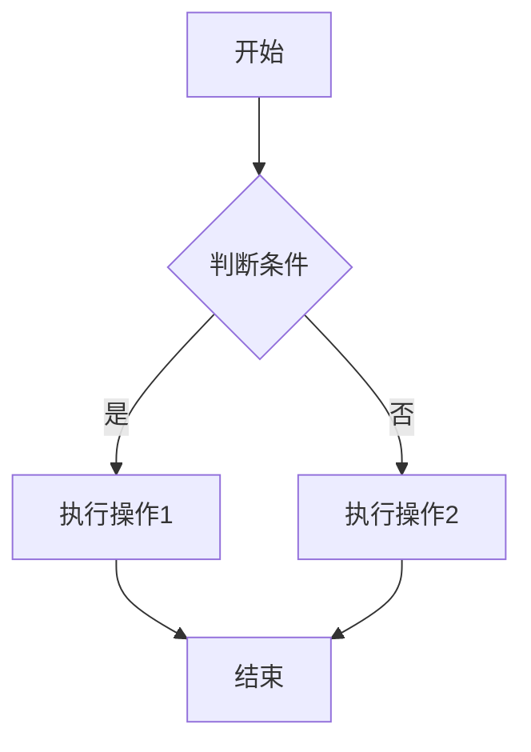
### 语法说明：
- graph TD：定义从上到下的流程图
- graph LR：定义从左到右的流程图
- A[文本]：矩形节点
- B{文本}：菱形判断节点
- -->：带箭头连接线
- -->|文本|：带标签的连接线

### 节点类型
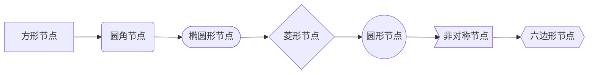

### 样式自定义
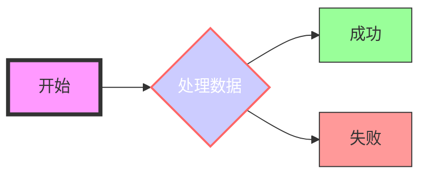

## 图表类型

### 1. 流程图


### 2. 子图

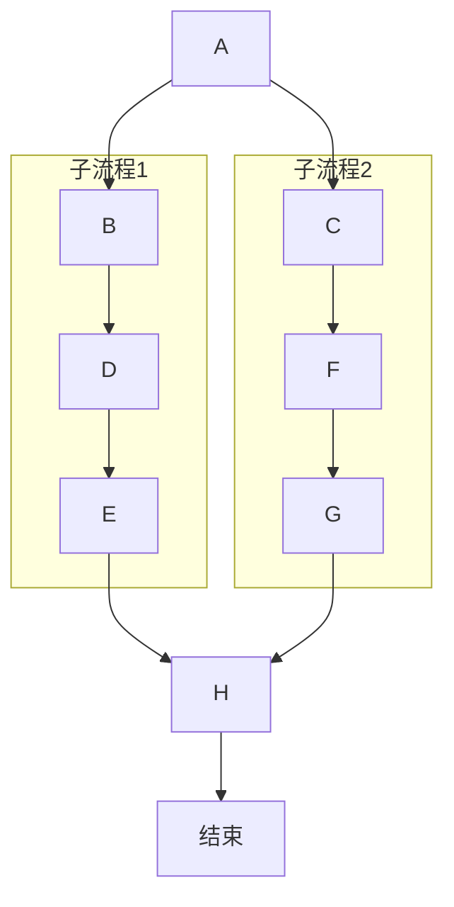

### 3. 时序图

#### 3.1 基本时序图

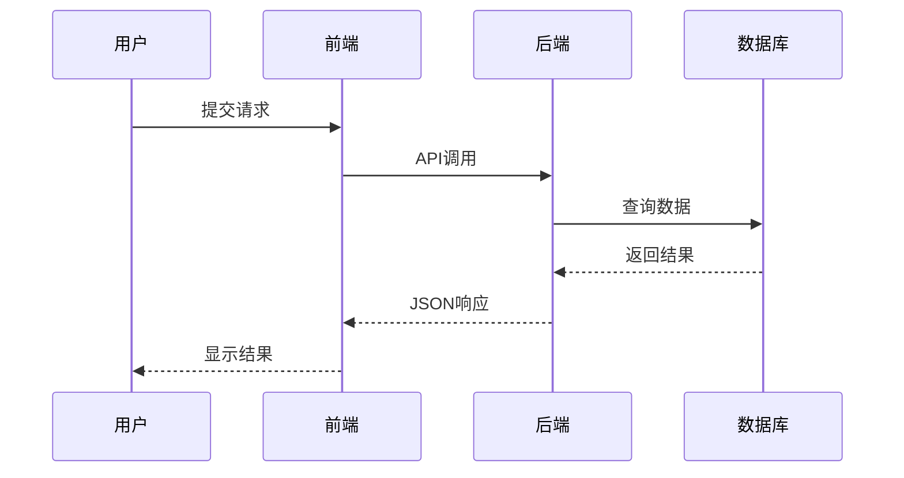
#### 3.2 消息类型

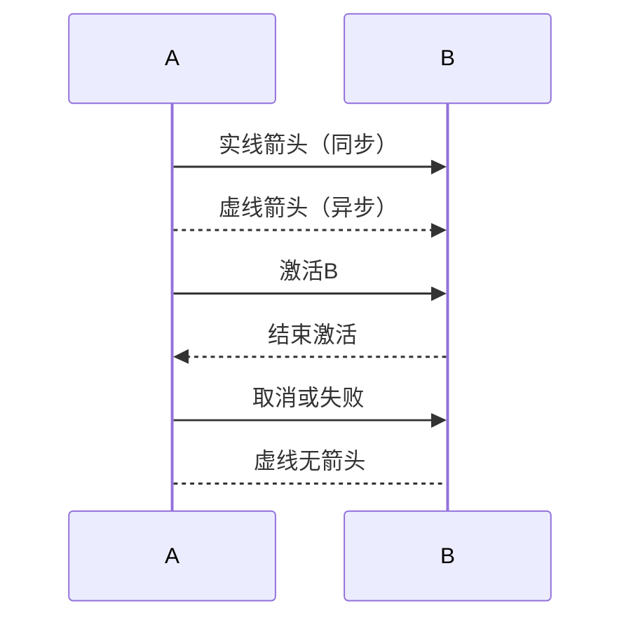
#### 3.3 循环和条件

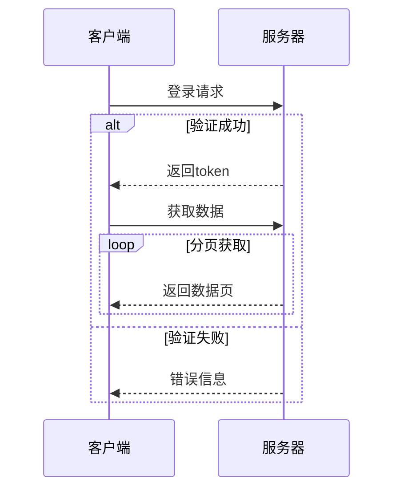

### 4 类图
#### 4.1 类定义

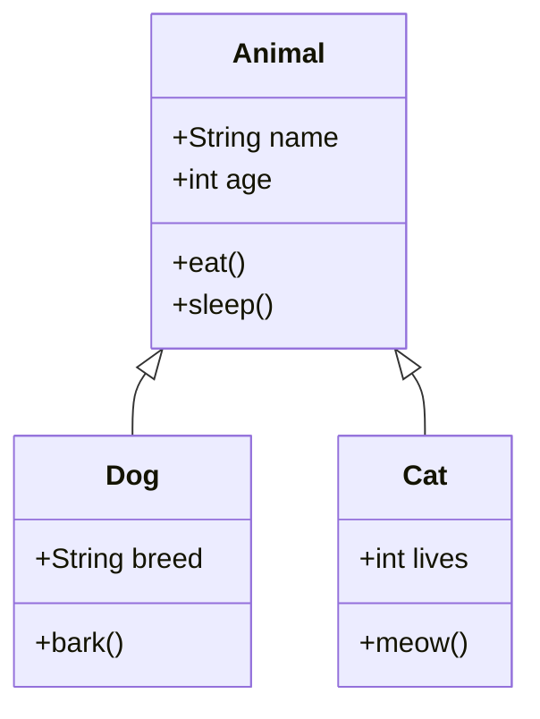
#### 4.2 关系类型

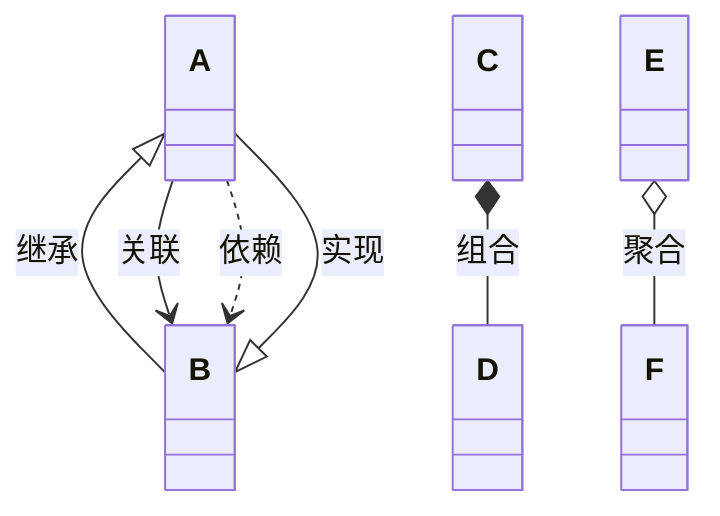
#### 4.3 类成员可见性

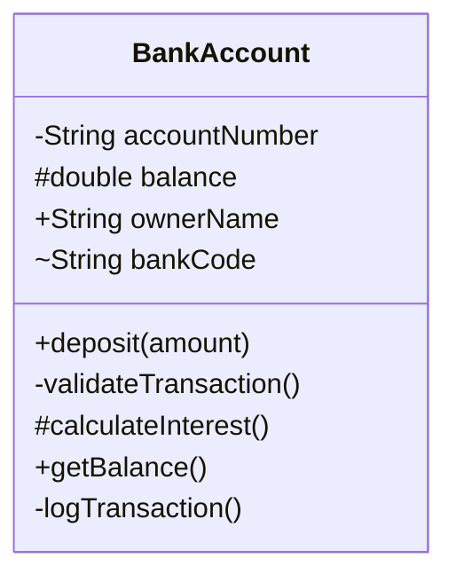

### 5 状态图
#### 5.1 基本状态图

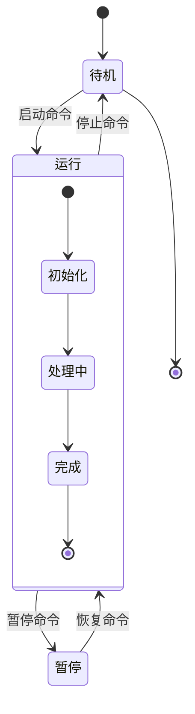
#### 5.1 并发状态

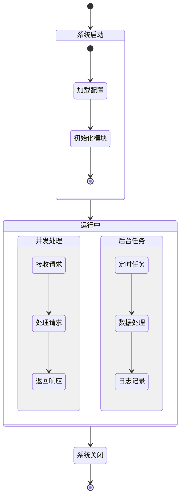

### 6. ER图
#### 6.1 数据库设计

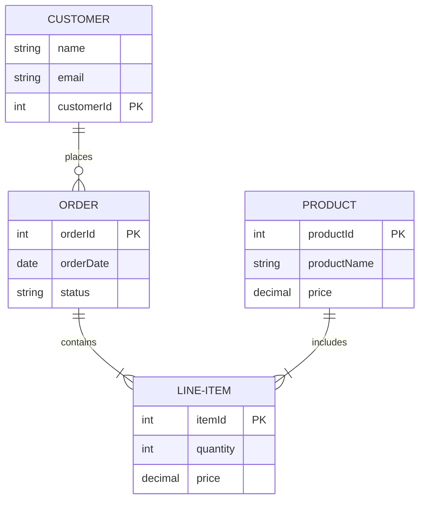

### 7. 用户旅程图

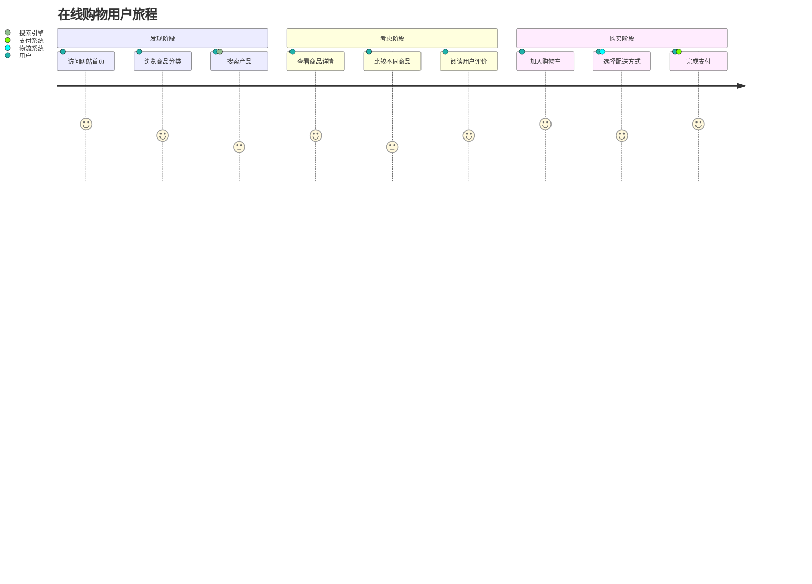

### 8. 甘特图
#### 8.1 项目计划

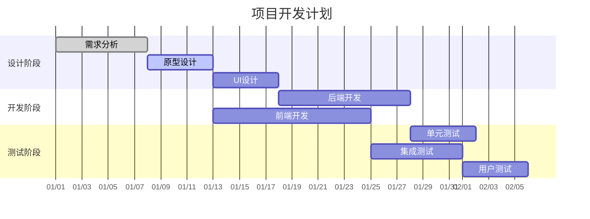

#### 8.2 里程碑

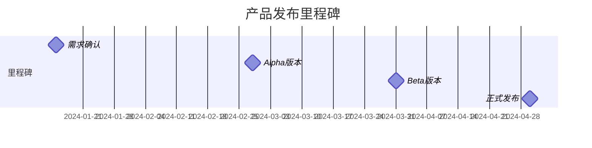

### 9. 饼状图

>:{.row}
>:: {.col-md-6}
#### 9.1 数据分布
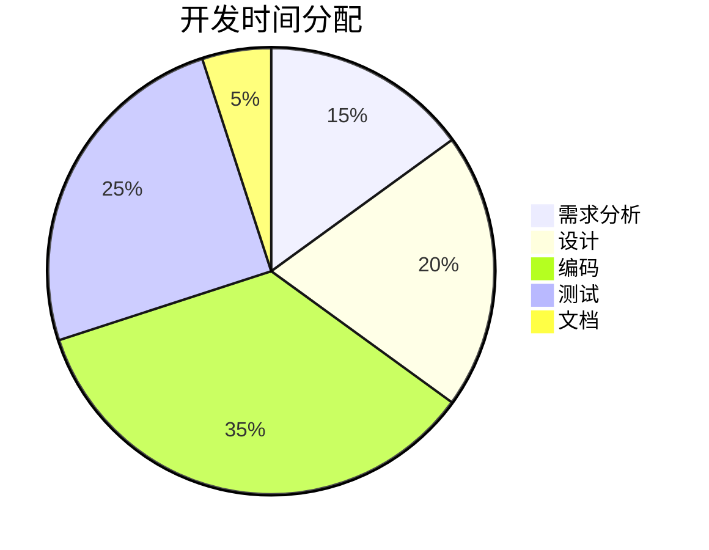
>:: {.col-md-6}
#### 9.2 带值显示
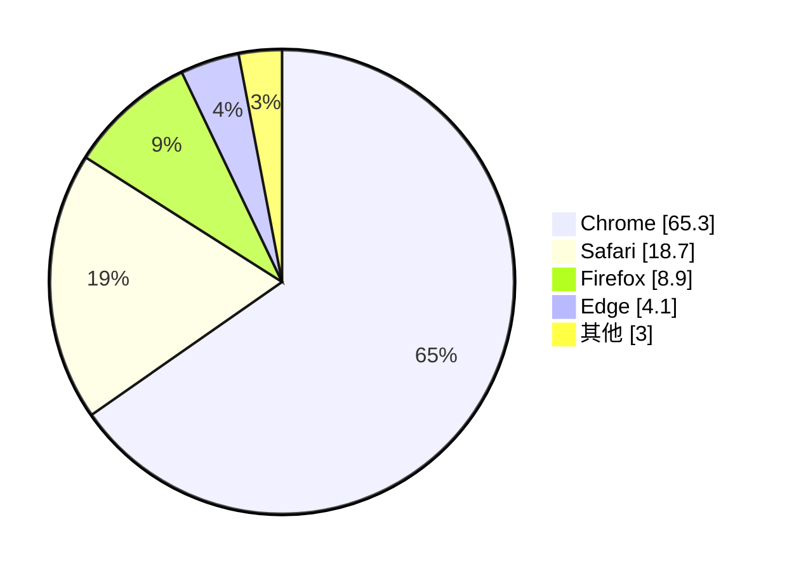
>!:

### 10. 柱状图

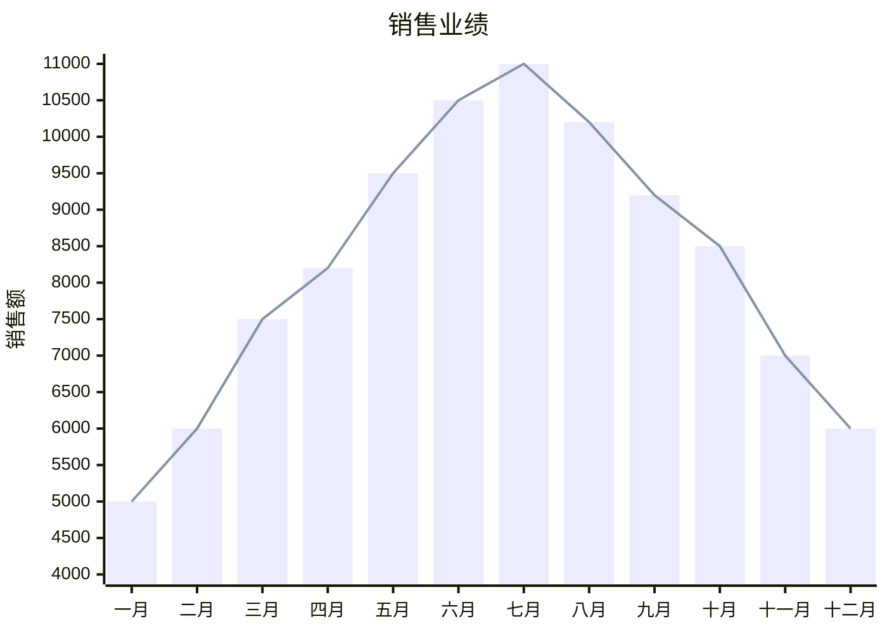

### 11. 象限图
#### 11.1 技术评估

```mermaid
quadrantChart
    title 技术栈评估矩阵
    x-axis "成熟度低" --> "成熟度高"
    y-axis "采用率低" --> "采用率高"
    quadrant-1 "评估"
    quadrant-2 "采纳"
    quadrant-3 "规避"
    quadrant-4 "验证"
    "React": [0.75, 0.80]
    "Vue.js": [0.65, 0.70]
    "Angular": [0.85, 0.60]
    "Svelte": [0.45, 0.35]
    "Next.js": [0.70, 0.75]
```

### 12. 需求图

```mermaid
requirementDiagram
    requirement test_req {
    id: 1
    text: "测试需求文本"
    risk: high
    verifymethod: test
    }

    element test_entity {
    type: simulation
    }

    test_entity - satisfies -> test_req

```

### 13. GitGraph图

```mermaid
graph TD
    A[main: 初始提交] --> B[main: 添加基础功能]
    B --> C[feature/user-auth: 分支创建]
    C --> D[user-auth: 添加用户注册]
    D --> E[user-auth: 添加用户登录]
    
    B --> F[main: 修复主分支bug]
    F --> G[feature/product-catalog: 分支创建]
    
    E --> J[user-auth: 添加密码加密]
    J --> K[main: 合并用户认证功能]
    F --> K
    
    classDef main fill:#e3f2fd,stroke:#1976d2
    classDef feature fill:#f3e5f5,stroke:#7b1fa2
    classDef merge fill:#e8f5e8,stroke:#388e3c
    
    class A,B,F main
    class C,D,E,G,H,I,J,L feature
    class K,M merge
```

### 14. 思维导图

```mermaid
mindmap
  root((项目规划))
    需求分析
      用户需求
      功能需求
      非功能需求
    设计阶段
      架构设计
      数据库设计
      UI设计
    开发阶段
      前端开发
      后端开发
      测试
    发布阶段
      部署
      监控
      维护

```

### 15. 时间线图

```mermaid
timeline
    title 项目时间线
    section 项目启动
        2023-01-01: 项目立项
        2023-01-10: 需求分析完成
    section 开发阶段
        2023-01-15: 设计评审通过
        2023-02-01: 开始开发
        2023-03-15: 功能开发完成
    section 测试阶段
        2023-03-20: 测试用例编写完成
        2023-04-10: 测试通过
    section 发布阶段
        2023-04-15: 预发布
        2023-04-20: 正式发布
```

### 16. Sankey图

```mermaid
---
config:
  sankey:
    showValues: false
---
sankey
    Agricultural 'waste',Bio-conversion,124.729
    Bio-conversion,Liquid,0.597
    Bio-conversion,Losses,26.862
    Bio-conversion,Solid,280.322
    Bio-conversion,Gas,81.144
    Biofuel imports,Liquid,35
    Biomass imports,Solid,35
    Coal imports,Coal,11.606
    Coal reserves,Coal,63.965
    Coal,Solid,75.571
    District heating,Industry,10.639
    District heating,Heating and cooling - commercial,22.505
    District heating,Heating and cooling - homes,46.184
    Electricity grid,Over generation / exports,104.453
    Electricity grid,Heating and cooling - homes,113.726
    Electricity grid,H2 conversion,27.14
    Electricity grid,Industry,342.165
    Electricity grid,Road transport,37.797
    Electricity grid,Agriculture,4.412
    Electricity grid,Heating and cooling - commercial,40.858
    Electricity grid,Losses,56.691
    Electricity grid,Rail transport,7.863
    Electricity grid,Lighting & appliances - commercial,90.008
    Electricity grid,Lighting & appliances - homes,93.494
    Gas imports,Ngas,40.719
    Gas reserves,Ngas,82.233
    Gas,Heating and cooling - commercial,0.129
    Gas,Losses,1.401
    Gas,Thermal generation,151.891
    Gas,Agriculture,2.096
    Gas,Industry,48.58
    Geothermal,Electricity grid,7.013
    H2 conversion,H2,20.897
    H2 conversion,Losses,6.242
    H2,Road transport,20.897
    Hydro,Electricity grid,6.995
    Liquid,Industry,121.066
    Liquid,International shipping,128.69
    Liquid,Road transport,135.835
    Liquid,Domestic aviation,14.458
    Liquid,International aviation,206.267
    Liquid,Agriculture,3.64
    Liquid,National navigation,33.218
    Liquid,Rail transport,4.413
    Marine algae,Bio-conversion,4.375
    Ngas,Gas,122.952
    Nuclear,Thermal generation,839.978
    Oil imports,Oil,504.287
    Oil reserves,Oil,107.703
    Oil,Liquid,611.99
    Other waste,Solid,56.587
    Other waste,Bio-conversion,77.81
    Pumped heat,Heating and cooling - homes,193.026
    Pumped heat,Heating and cooling - commercial,70.672
    Solar PV,Electricity grid,59.901
    Solar Thermal,Heating and cooling - homes,19.263
    Solar,Solar Thermal,19.263
    Solar,Solar PV,59.901
    Solid,Agriculture,0.882
    Solid,Thermal generation,400.12
    Solid,Industry,46.477
    Thermal generation,Electricity grid,525.531
    Thermal generation,Losses,787.129
    Thermal generation,District heating,79.329
    Tidal,Electricity grid,9.452
    UK land based bioenergy,Bio-conversion,182.01
    Wave,Electricity grid,19.013
    Wind,Electricity grid,289.366
```

### 17. 块图

```mermaid
block
columns 1
  db(("DB"))
  blockArrowId6<["&nbsp;&nbsp;&nbsp;"]>(down)
  block:ID
    A
    B["A wide one in the middle"]
    C
  end
  space
  D
  ID --> D
  C --> D
  style B fill:#969,stroke:#333,stroke-width:4px
```

### 18. 数据包图

```mermaid
packet
    0-15: "16位源端口"
    16-31: "16位目的端口"
    32-63: "序列号（32位）"
    64-95: "确认序列码（32位）"
    96-99: "4位首部长度"
    100-105: "6位保留"
    106: "URG"
    107: "ACK"
    108: "PSH"
    109: "RST"
    110: "SYN"
    111: "FIN"
    112-127: "窗口大小（16位）"
    128-143: "校验和（16位）"
    144-159: "紧急指针（16位）"
    160-191: "8位填充"
    192-255: "数据区（可变长度）"
```

### 19. 看板图

```mermaid
kanban
  任务
    [创建文档]
    docs[创建关于新图表的博客]
  进行中
    id6[创建渲染器，确保在所有情况下都能正常工作。我们还添加了一些额外的文本，用于测试目的。并添加了一些额外的文本，用于增加 flare。]
  id9[准备部署]
    id8[设计语法]@{ assigned: 'knsv' }
  id10[测试准备]
    id4[创建解析测试]@{ ticket: MC-2038, assigned: 'K.Sveidqvist', priority: 'High' }
    id66[最后一项]@{ priority: 'Very Low', assigned: 'knsv' }
  id11[完成]
    id5[定义getData函数]
    id2[标题超过100个字符时，复制100个字符的图表会导致标题截断]@{ ticket: MC-2036, priority: 'Very High'}
    id3[更新数据库函数]@{ ticket: MC-2037, assigned: knsv, priority: 'High' }

  id12[无法复现]
    id3[在Firefox中出现奇怪的闪烁]

```

### 20. 架构图

```mermaid
architecture-beta
    group api(cloud)[API]

    service db(database)[Database] in api
    service disk1(disk)[Storage] in api
    service disk2(disk)[Storage] in api
    service server(server)[Server] in api

    db:L -- R:server
    disk1:T -- B:server
    disk2:T -- B:db

```

### 21. 雷达图

```mermaid
radar-beta
  axis m["数学"], s["科学"], e["英语"]
  axis h["历史"], g["地理"], a["艺术"]
  curve a["爱丽丝"]{85, 90, 80, 70, 75, 90}
  curve b["鲍勃"]{70, 75, 85, 80, 90, 85}

  max 100
  min 0
```

### 22. 树状图

```mermaid
treemap-beta
    "第一分块"
        "子分支": 12
        "子分块":::class1
          "子分块分支1": 12
    "第二块分"
        "子分支1": 20:::class1
        "子分支2": 25
        "子分支3": 12

    classDef class1 fill:red,color:blue,stroke:#FFD600;
```

## 实用技巧和最佳实践
### 1. 主题定制
```css
// 自定义主题示例
{
  theme: 'base',
  themeVariables: {
    primaryColor: '#BB2528',
    primaryTextColor: '#fff',
    primaryBorderColor: '#7C0000',
    lineColor: '#F8B229',
    secondaryColor: '#006B00',
    tertiaryColor: '#fff'
  }
}
```
### 2. Markdown内的写法
```markdown
# 项目文档

## 系统架构

\```mermaid
graph TD
    客户端 --> 负载均衡器
    负载均衡器 --> Web服务器1
    负载均衡器 --> Web服务器2
    Web服务器1 --> 数据库
    Web服务器2 --> 数据库
\```

## API调用流程

\```mermaid
sequenceDiagram
    客户端->>API网关: 请求
    API网关->>认证服务: 验证token
    认证服务-->>API网关: 验证结果
    API网关->>业务服务: 转发请求
    业务服务-->>客户端: 返回响应
\```
```
### 3.性能优化建议

- 避免过度复杂：单个图表不要超过50个节点
- 使用子图：将相关逻辑分组到子图中
- 精简文本：节点文本尽量简洁
- 适当使用注释：使用Note添加说明而非长文本节点

### 4 常见问题解决
#### 问题1：图表渲染不完整
```
解决方案：
1. 检查语法是否正确闭合
2. 确保没有嵌套过深
3. 验证特殊字符是否正确转义
```
#### 问题2：样式不生效
```
解决方案：
1. 确认主题文件正确加载
2. 检查CSS选择器是否正确
3. 验证样式优先级
```
#### 问题3：与编辑器的兼容性问题
```
解决方案：
1. 使用最新的Mermaid版本
2. 检查编辑器的Mermaid插件版本
3. 考虑使用在线编辑器预览
```

## 实际应用案例
### 1. 微服务架构图
```mermaid
graph TB
    subgraph 网关层
        GW[API网关]
        LB[负载均衡]
    end
    
    subgraph 业务服务
        A[用户服务]
        B[订单服务]
        C[支付服务]
        D[商品服务]
    end
    
    subgraph 基础设施
        E[认证中心]
        F[配置中心]
        G[消息队列]
        H[日志服务]
    end
    
    subgraph 数据层
        DB1[(用户数据库)]
        DB2[(订单数据库)]
        DB3[(商品数据库)]
    end
    
    客户端 --> LB --> GW
    GW --> A
    GW --> B
    GW --> C
    GW --> D
    
    A --> E
    A --> F
    A --> G
    A --> H
    
    A --> DB1
    B --> DB2
    D --> DB3
    
    B --> C
    C --> G
```
### 2.CI/CD流水线
```mermaid
graph LR
    subgraph 开发阶段
        A[代码提交] --> B[代码审查]
        B --> C[自动化测试]
    end
    
    subgraph 构建阶段
        C --> D[构建镜像]
        D --> E[安全扫描]
        E --> F[镜像推送]
    end
    
    subgraph 部署阶段
        F --> G[预发布环境]
        G --> H[集成测试]
        H --> I[性能测试]
        I --> J[生产部署]
    end
    
    subgraph 监控阶段
        J --> K[监控告警]
        K --> L[日志分析]
        L --> M[用户反馈]
        M --> N[迭代优化]
    end
    
    N -.-> A
```


更多图表示例见本文「高级图表示例」章节。