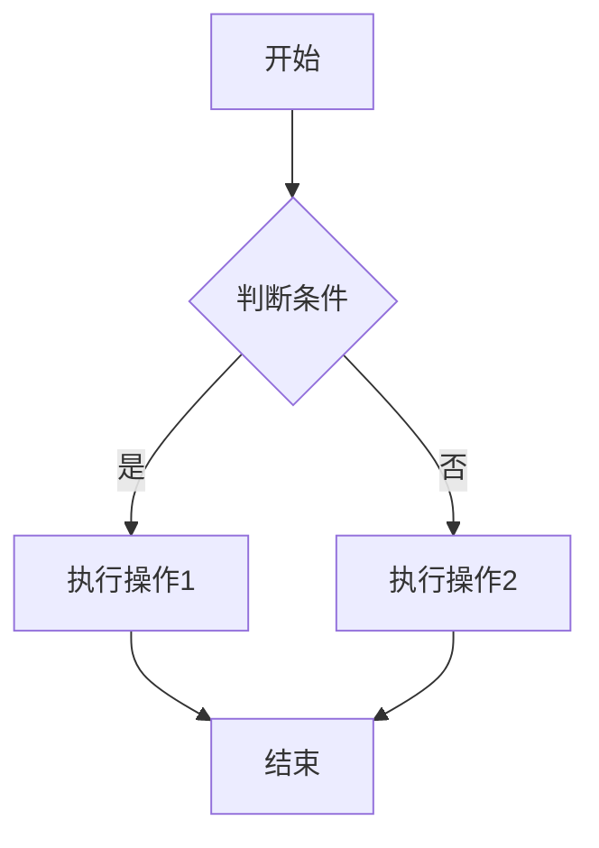

# 图表使用指南

## Mermaid 图表


[Mermaid学习指南](./Mermaid学习指南)

## Chart.js
```chartjs
const footer = (tooltipItems) => {
  let sum = 0;

  tooltipItems.forEach(function(tooltipItem) {
    sum += tooltipItem.parsed.y;
  });
  return 'Sum: ' + sum;
};
const DATA_COUNT = 7;
const NUMBER_CFG = {count: DATA_COUNT, min: -100, max: 100, decimals: 0};
const data = {
  labels: Utils.months({count: DATA_COUNT}),
  datasets: [
    {
      label: 'Dataset 1',
      data: Utils.numbers(NUMBER_CFG),
      fill: false,
      borderColor: Utils.CHART_COLORS.red,
      backgroundColor: Utils.transparentize(Utils.CHART_COLORS.red, 0.5),
    },
    {
      label: 'Dataset 2',
      data: Utils.numbers(NUMBER_CFG),
      fill: false,
      borderColor: Utils.CHART_COLORS.blue,
      backgroundColor: Utils.transparentize(Utils.CHART_COLORS.blue, 0.5),
    },
  ]
};
var config = {
  type: 'line',
  data: data,
  options: {
    interaction: {
      intersect: false,
      mode: 'index',
    },
    plugins: {
      tooltip: {
        callbacks: {
          footer: footer,
        }
      }
    }
  }
};
```


## 流程图

```flow
+++config
// 定义样式
var options = {
    'x': 0,
    'y': 0,
    'line-width': 3,
    'line-length': 50,
    'text-margin': 10,
    'font-size': 14,
    'font-color': 'black',
    'line-color': 'black',
    'element-color': 'black',
    'fill': 'white',
    'yes-text': 'yes',
    'no-text': 'no',
    'arrow-end': 'block',
    'scale': 1,
    'symbols': {
    'start': {
        'font-color': 'red',
        'element-color': 'green',
        'fill': 'yellow'
    },
    'end':{
        'class': 'end-element'
    }
    },
    'flowstate' : {
    'past' : { 'fill' : '#CCCCCC', 'font-size' : 12},
    'current' : {'fill' : 'yellow', 'font-color' : 'red', 'font-weight' : 'bold'},
    'future' : { 'fill' : '#FFFF99'},
    'request' : { 'fill' : 'blue'},
    'invalid': {'fill' : '#444444'},
    'approved' : { 'fill' : '#58C4A3', 'font-size' : 12, 'yes-text' : 'APPROVED', 'no-text' : 'n/a' },
    'rejected' : { 'fill' : '#C45879', 'font-size' : 12, 'yes-text' : 'n/a', 'no-text' : 'REJECTED' }
    }
};
+++
st=>start: Start|past:>http://www.google.com[blank]
e=>end: End|future:>http://www.google.com
op1=>operation: My Operation|past
op2=>operation: Stuff|current
sub1=>subroutine: My Subroutine|invalid
cond=>condition: Yes
or No?|approved:>http://www.google.com
c2=>condition: Good idea|rejected
io=>inputoutput: catch something...|future

st->op1(right)->cond
cond(yes, right)->c2
cond(no)->sub1(left)->op1
c2(yes)->io->e
c2(no)->op2->e
```

## 思维导图
```markmap 700px,90%,1000px
# Markmap 示例导图

## 主要功能
- 将 Markdown 转换为思维导图
- 支持交互式操作
  - 展开/折叠节点
  - 缩放和平移
- **轻量级**
- 易于集成

## 如何使用
### HTML
- 引入 D3.js
- 引入 markmap-lib
- 引入 markmap-view
- 准备一个 SVG 容器

### JavaScript
\\`\\`\\`js
// 示例代码
const transformer = new markmap.Transformer();
const { root, features } = transformer.transform(markdownContent);
markmap.Markmap.create('#markmap', null, root);
\\`\\`\\`

## 优点
- 学习成本低 (Markdown)
- **代码即图**
- 社区活跃
- 跨平台支持

## 缺点
- 无法绘制非层级图表 (如流程图、甘特图)
- 定制性不如纯 JS 图表库 (如 ECharts) 灵活
```

## echarts
```echarts
// 基于准备好的dom，初始化echarts实例
var myChart = echarts.init(document.getElementById(tableName));
var option = {
  xAxis: {
    data: ['衬衫', '羊毛衫', '雪纺衫', '裤子', '高跟鞋', '袜子']
  },
  yAxis: {},
  series: [
    {
      name: '销量',
      type: 'bar',
      data: [5, 20, 36, 10, 10, 20]
    }
  ]
};
// 使用刚指定的配置项和数据显示图表。
myChart.setOption(option);
// 处理点击事件并且跳转到相应的百度搜索页面
myChart.on('click', function(params) {
  window.open('https://www.baidu.com/s?wd=' + encodeURIComponent(params.name));
});
```